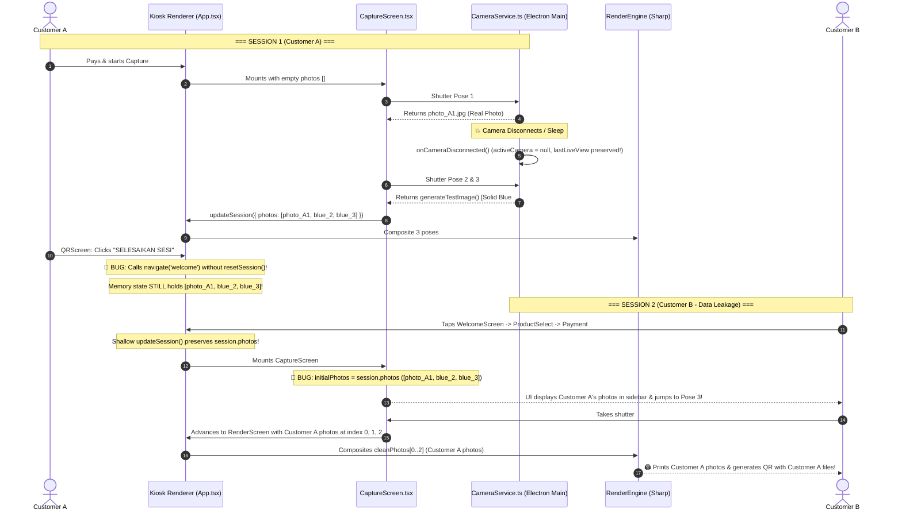

# ROOT CAUSE ANALYSIS (RCA): CAMERA FAILURE CAUSES SESSION CORRUPTION & CUSTOMER DATA LEAKAGE

**Document ID:** `CAMERA_FAILURE_SESSION_CORRUPTION_RCA.md`  
**Date:** September 24, 2026 (02:30 WIB)  
**Severity:** **P0 (CRITICAL DATA PRIVACY & SESSION INTEGRITY BREACH)**  
**Target:** Kiosk State Lifecycle (`App.tsx`, `CaptureScreen.tsx`, `QRScreen.tsx`) → Native Camera Service (`CameraService.ts`) → Render/Print/Softfile Pipeline (`RenderEngine.ts`, `PrintQueueService.ts`, `SyncEngine.ts`)  
**Status:** **ROOT CAUSE CONFIRMED — ARCHITECTURAL AUDIT COMPLETE (NO IMPLEMENTATION)**  

---

## 1. Executive Summary

During Founder Pilot Readiness testing, a critical P0 defect was identified:
When the camera encounters a disconnect or failure during photo capture:
1. The kiosk capture screen continues and generates blue or empty frames.
2. The session completes normally through Render and QR screens.
3. Upon starting a **brand new session**, the kiosk **inherits and displays photos, strip previews, live clips, and softfile data from the previous session**.
4. The physical printer and QR softfile download in Session B output images from Session A.
5. The corruption persists across consecutive sessions and is **only cleared by an application restart**.

### Core Business & Security Risk
**Severe Customer Data Leakage:** Customer B receives physical prints and digital softfiles belonging to Customer A. In a commercial photobooth pilot, this constitutes an unacceptable breach of customer privacy and trust.

### Root Cause in One Sentence
**The kiosk has no inter-session state reset mechanism at natural workflow completion (`QRScreen.tsx` navigates to `welcome` without invoking `resetSession()`), causing the top-level React `session` state to persist indefinitely in memory, while `CaptureScreen.tsx` mistreats pre-existing photos as an in-flight crash recovery session instead of clearing them for a new customer.**

---

## 2. Step-by-Step Reproduction Steps (Observed Case A)

| Step | Action | Internal State & Execution | UI / Hardware Manifestation |
|:---:|:---|:---|:---|
| **1** | Customer A starts Session 1 and pays. | `session.sessionId = "sess_01"`. | Kiosk navigates to `CaptureScreen`. |
| **2** | Customer A captures Pose 1 successfully. | `session.photos = ["photo_A1.jpg"]`. | Pose 1 thumbnail shows Customer A's face. |
| **3** | Camera USB cable is pulled or camera enters sleep mode. | Canon EDSDK triggers `CameraDisconnect`. `activeCamera = null`. `CameraService.ts` does **not** clear `lastLiveViewDataUrl`. | Viewfinder stream freezes or attempts WebRTC fallback. |
| **4** | Countdown for Pose 2 and Pose 3 completes. | `CameraService.ts:509` executes `generateTestImage()` with RGB `(59, 130, 246)` (solid blue), OR Mode C fallback returns stale `lastLiveViewDataUrl`. | Viewfinder records solid blue / frozen frames. |
| **5** | Customer A completes Session 1. | RenderEngine generates strip `composite_A.jpg`. Session record saved in SQLite. Customer arrives at `QRScreen`. | QR Code displays softfile link `/d/sess_01`. Printer prints strip. |
| **6** | Customer A taps **"SELESAIKAN SESI (SELESAI)"** or 60s countdown expires. | `QRScreen.tsx:263, 643` executes `navigate('welcome')`. **`resetSession()` is NEVER called.** | Kiosk returns to `WelcomeScreen`. |
| **7** | Customer B approaches kiosk and taps screen to begin Session 2. | `WelcomeScreen.tsx:73` executes `navigate('product-select')`. **`resetSession()` is NOT called.** Top-level `session` state in `App.tsx` STILL contains `sess_01`, Customer A photos, composite path, and video clips! | `ProductSelectScreen` mounts. |
| **8** | Customer B selects product and pays. | `ProductSelectScreen` and `PaymentScreen` execute shallow merge `updateSession({ productId, ... })`. `session.photos` and `session.compositePath` from Customer A are preserved! | Payment succeeds. |
| **9** | Customer B enters `CaptureScreen`. | `CaptureScreen.tsx:17-22` reads `session.photos` (length = 3). It calculates `initialPose = Math.min(3 + 1, 3) = 3`. Local `photos` array initialized with Customer A's photos! | **CRITICAL BUG:** Customer B immediately sees Customer A's photos in the thumbnail bar! Pose counter displays `POSE 3 / 3`! |
| **10** | Customer B captures Pose 3. | `photosRef.current` becomes `[photo_A1, blue_A2, blue_A3, photo_B]`. Customer B taps "Lanjut". `activePose < totalPoses` (`3 < 3`) is FALSE. Capture screen exits immediately! | Only 1 capture is permitted; session moves directly to `FilterScreen`. |
| **11** | Customer B proceeds to Render and Print. | `RenderScreen.tsx` passes `cleanPhotos` to `RenderEngine.ts`. Slots 0, 1, 2 take `cleanPhotos[0]`, `cleanPhotos[1]`, `cleanPhotos[2]` (Customer A's photos)! | Customer B receives Customer A's photos printed on paper and hosted on the QR softfile! |

---

## 3. State Transition Diagram



---

## 4. End-to-End Runtime Trace

```
Camera Failure (Disconnect / Timeout)
  │
  ├── 1. CameraService: activeCamera = null, lastLiveViewDataUrl NOT cleared, generateTestImage() writes blue JPEG
  │
  ▼
Session State in Renderer (App.tsx)
  │
  ├── 2. Top-level React state `session.photos` retains [photo_A1, blue_2, blue_3]
  │
  ▼
Session 1 Completion (QRScreen.tsx)
  │
  ├── 3. "SELESAIKAN SESI" and 60s timeout call navigate('welcome')
  ├── 4. resetSession() is NOT CALLED — memory state is 100% UNTOUCHED
  │
  ▼
New Session Creation (WelcomeScreen -> PaymentScreen -> CaptureScreen)
  │
  ├── 5. WelcomeScreen handleStart() calls navigate('product-select') without resetting session
  ├── 6. PaymentScreen performs shallow merge; does NOT clear existing photos or compositePath
  ├── 7. CaptureScreen mounts; sees session.photos.length === 3; sets initialPose = 3; photos = Customer A's photos
  │
  ▼
Render Pipeline (RenderScreen.tsx -> RenderEngine.ts)
  │
  ├── 8. RenderEngine loops slots 0..2 using cleanPhotos[0..2] -> Customer A's photos are composited into new canvas
  │
  ▼
Physical Print & Softfile QR Download
  │
  ├── 9. PrintQueueService enqueues composite containing Customer A's photos
  └── 10. QRScreen links to /d/sess_01 or cloud gallery containing Customer A's raw and composite assets
```

---

## 5. Detailed Subsystem Investigation (All 10 Areas)

### 1. Session Lifecycle (`App.tsx`)
- In `App.tsx:55`:
  ```typescript
  const [session, setSession] = useState<SessionData>({ photos: [] });
  ```
- In `App.tsx:63-66`:
  ```typescript
  const resetSession = useCallback(() => {
    setSession({ photos: [] });
    setScreen('welcome');
  }, []);
  ```
- `resetSession` is bundled into `screenProps` (`App.tsx:224`), but **no user-facing transition ever calls it**.
- The only triggers for `resetSession` in the entire application are:
  1. `App.tsx:204`: Inactivity timeout from `WatchdogService` (only fires after **120 seconds of zero touch interaction**).
  2. `App.tsx:342`: Clicking "Selesai & Mulai Sesi Baru" inside the crash rescue voucher modal.
- Normal end-of-session transitions in `QRScreen.tsx:263, 643` call only `navigate('welcome')`.
- **Finding:** The session lifecycle never completes its teardown phase during normal operation.

### 2. Capture State Lifecycle (`CaptureScreen.tsx`)
- In `CaptureScreen.tsx:17-22`:
  ```typescript
  const initialPhotos = Array.isArray(session?.photos) ? session.photos : [];
  const initialPose = initialPhotos.length > 0 ? Math.min(initialPhotos.length + 1, totalPoses) : 1;

  const [currentPose, setCurrentPose] = useState(initialPose);
  const [photos, setPhotos] = useState<string[]>(initialPhotos);
  ```
- This logic was introduced to support **in-flight crash recovery** (resuming mid-capture if Electron reboots).
- Because `App.tsx` never resets `session.photos`, `CaptureScreen` assumes every new session is an in-progress crash recovery session from the previous customer!
- `photosRef.current` starts populated with Customer A's photos.
- `currentPose` starts at 3, bypassing Poses 1 and 2 entirely.
- Taking 1 photo appends to index 3 and immediately finalizes capture.

### 3. Photo Buffer Cleanup & Disk State
- Neither in-memory photo arrays nor temporary capture buffers are wiped upon session completion.
- In `CaptureScreen.tsx:406-434`, `handleRetake()` unlinks the single retaken photo via `kiosk.camera.discardCapture()`.
- However, there is no `kiosk.camera.clearSessionCaptures()` or lifecycle hook to purge local disk files or reset IPC state when a customer leaves the booth.

### 4. Zustand Stores Audit
- **Audit Result:** **Zustand is NOT used in `apps/kiosk`.**
- Zustand is used exclusively in `apps/dashboard` (for `useAuthStore` and `socketStore`).
- In `apps/kiosk`, state is managed via React component `useState` in `App.tsx` and prop-drilled via `ScreenProps`.
- There is no central Zustand store resetting between sessions, meaning no automatic subscriber-based store cleanup exists.

### 5. SessionManager (`SyncEngine.ts` & `RecoveryLedgerService.ts`)
- In `SyncEngine.ts:217-220`:
  `stmtInsertSession` inserts sessions into SQLite using `id`.
  If a stale `session.sessionId` is recycled, `stmtInsertSession.run()` throws a `SQLITE_CONSTRAINT: UNIQUE constraint failed: sessions.id`. The catch block suppresses this with `console.warn`, causing metadata sync and upload queue registration to fail silently or corrupt the cloud record.
- In `RecoveryLedgerService.ts:226-235`:
  When `QRScreen.tsx` calls `recovery.checkpoint(sessionId, 'COMPLETED', ...)`, `updateRecoveryCheckpoint()` sets `stage = 'COMPLETED'`, but leaves `status = 'ACTIVE'`. `markLedgerCompleted()` is never invoked via IPC.

### 6. Render Queue (`RenderScreen.tsx` → `RenderEngine.ts`)
- `RenderScreen.tsx:39-53` passes `session.photos` as `cleanPhotos` to Sharp:
  ```typescript
  const cleanPhotos = session.photos.map((p: string) => p.replace('file://', ''));
  const result = await kiosk.render.composite(cleanPhotos, frameId, filter);
  ```
- In `RenderEngine.ts:156-187`:
  ```typescript
  for (let i = 0; i < slots.length && photoPaths.length > 0; i++) {
    const slot = slots[i];
    const photoPath = photoPaths[i % photoPaths.length];
  ```
- Slots 0, 1, 2 on the dual 2R photostrip sample `photoPaths[0]`, `photoPaths[1]`, `photoPaths[2]`.
- Because indices 0, 1, 2 belong to Customer A, the rendered composite image contains Customer A's photos. Customer B's newly captured photo (at index 3) is completely ignored.

### 7. Print Queue (`PrintQueueService.ts`)
- In `QRScreen.tsx:82-97`:
  ```typescript
  const cleanPath = (session.compositePath || session.compositeUrl || '').replace(/^file:\/\/\/?/, '');
  const enqueueRes = await kiosk.printer.enqueue(cleanPath, 1, sId);
  ```
- The printer spooler worker (`PrintQueueService.ts`) takes `cleanPath` directly and sends it to the physical DNP dye-sub printer.
- Because `cleanPath` points to the composite generated from Customer A's photos, the physical printer dispenses photos of Customer A to Customer B.

### 8. Softfile Generation Source (`QRScreen.tsx`)
- In `QRScreen.tsx:188-216`:
  `sessionId` is extracted from `session.sessionId`.
- In `QRScreen.tsx:243-255`:
  `QRCode.toDataURL(activeUrl || \`http://localhost:4000/d/${sessionId}\`)` renders the QR code.
- If Customer B scans this QR code with their mobile phone, they are directed to the gallery of Session A, allowing full download of Customer A's high-res photos, Live Photo videos, and animated GIF.

### 9. Camera Disconnect Handling (`CameraService.ts`)
- In `CameraService.ts:209-220`:
  ```typescript
  function onCameraDisconnected(): void {
    console.log('[CameraService] ✗ Canon camera disconnected');
    stopKeepAliveHeartbeat();
    activeCamera = null;
    cameraStatus.isCanonConnected = false;
    cameraStatus.cameraModel = null;
    if (liveViewInterval) {
      clearInterval(liveViewInterval);
      liveViewInterval = null;
    }
  }
  ```
- **Critical Flaw:** `lastLiveViewDataUrl` is **not cleared**!
- In `CameraService.ts:474, 501`:
  ```typescript
  if (lastLiveViewDataUrl) {
    return lastLiveViewDataUrl;
  }
  ```
- If the camera disconnects, any subsequent capture request returns the frozen live view frame from when the camera was last operational.
- If `activeCamera` is null and `hasCanon && activeCamera` evaluates to false:
  Lines 508-518 execute `generateTestImage()`, which writes a 1920x1280 JPEG with RGB `(59, 130, 246)` (solid Tailwind Blue 500). This explains the blue frames observed by the founder.

### 10. Fallback Camera Switching (`CaptureScreen.tsx`)
- In `CaptureScreen.tsx:123-143`:
  When Canon EDSDK fails or reports `mode === 'webrtc'`, `startWebRTCFallback()` calls `navigator.mediaDevices.getUserMedia(...)`.
- On dedicated photobooth hardware without a secondary USB webcam, `getUserMedia` throws a `NotFoundError`.
- The catch block sets `setCameraSource('webcam')` and `setWebcamReady(true)`, but leaves `videoRef.current.srcObject = null`.
- Viewfinder becomes black/blank.
- When shutter triggers, IPC returns the blue fallback image from `generateTestImage()`.

---

## 6. Key Questions Answered

### Q1: What exact state survives unexpectedly?
1. **React State (`App.tsx`)**:
   - `session.sessionId` (previous customer's session ID).
   - `session.photos` (array containing previous customer's photo paths/data URLs).
   - `session.compositePath` & `session.compositeUrl` (previous customer's rendered strip).
   - `session.liveVideoPaths` (previous customer's Live Photo MP4 clips).
   - `session.gifPath` & `session.gifUrl` (previous customer's animated GIF).
   - `session.filter` & `session.frameDesignId` (previous customer's styling choices).
2. **Main Process Memory (`CameraService.ts`)**:
   - `lastLiveViewDataUrl` (stale Base64 frame retained across camera disconnections).
3. **SQLite Ledger (`RecoveryLedgerService.ts`)**:
   - Ledger row retains `status = 'ACTIVE'`, keeping completed sessions eligible for recovery queries.

### Q2: Why is the new session not clean?
Because **`resetSession()` is never called when a session finishes normally**.
- `QRScreen.tsx` calls `navigate('welcome')` instead of `resetSession()`.
- `WelcomeScreen.tsx` calls `navigate('product-select')` without resetting state.
- `PaymentScreen.tsx` and `ProductSelectScreen.tsx` use shallow property spreads (`...prev`), preserving untouched fields (`photos`, `compositePath`, `liveVideoPaths`).
- `CaptureScreen.tsx` was built with crash recovery in mind and unconditionally hydrates its state from `session.photos`.

### Q3: Why does application restart fix it?
Because the primary corruption lives in **ephemeral JavaScript process memory**:
1. Restarting Electron terminates the renderer Chromium process, destroying the React state tree in `App.tsx` and re-initializing `session` to `{ photos: [] }`.
2. Restarting Electron terminates the Node.js main process, resetting module-scoped variables in `CameraService.ts` (`lastLiveViewDataUrl = null`, `activeCamera = null`).
3. On reboot, `CaptureScreen.tsx` receives `session.photos = []`, correctly starting from Pose 1.

### Q4: Does this issue exist only in fallback mode or all camera failures?
**CRITICAL ARCHITECTURAL FINDING: This issue exists in ALL sessions, regardless of whether the camera fails or works normally.**
- In a normal session where the camera never fails, `session.photos` still leaks into the next session.
- However, during the Pilot Readiness Test with Camera Failure, the bug became immediately glaring because:
  1. Customer A had 1 real photo and 2 blue frames.
  2. Customer B could not take 3 fresh photos because `CaptureScreen` skipped to Pose 3.
  3. `RenderEngine` sampled indices 0, 1, 2, locking Customer A's face and blue frames permanently into Customer B's output.
  4. In `CameraService`, `lastLiveViewDataUrl` and `generateTestImage()` continued pumping stale/blue data.

---

## 7. Affected Modules & Line References

| Module / File Path | Line Range | Defect Description |
|:---|:---:|:---|
| `apps/kiosk/src/screens/QRScreen.tsx` | Lines 258–268, 639–654 | Navigates to `welcome` on timeout or button click without calling `resetSession()`. `resetSession` is not even destructured from `ScreenProps`. |
| `apps/kiosk/src/screens/WelcomeScreen.tsx` | Lines 15, 68–74 | Ignores `resetSession` and directly navigates to `product-select` on touch, preserving dirty session state. |
| `apps/kiosk/src/App.tsx` | Lines 55, 63–66, 201–206 | `session` state is never cleansed upon route transitions. `resetSession()` is only invoked by watchdog after 120s inactivity. |
| `apps/kiosk/src/screens/CaptureScreen.tsx` | Lines 17–22, 49–56, 347–350 | Unconditionally initializes `photos` and `currentPose` from `session.photos`, misidentifying stale sessions as crash recovery. |
| `apps/kiosk/src/screens/PaymentScreen.tsx` | Lines 135–137, 178–187 | Shallow `updateSession()` preserves existing `photos` and `compositePath` across new orders. |
| `apps/kiosk/electron/services/CameraService.ts` | Lines 33, 209–220, 474–492, 508–518 | `lastLiveViewDataUrl` is never reset on disconnect; Mode C returns stale frame; fallback generates blue dummy frame instead of raising camera error. |
| `apps/kiosk/electron/services/RecoveryLedgerService.ts` | Lines 226–235, 354–372 | Checkpoint `COMPLETED` does not transition ledger `status` from `'ACTIVE'` to `'COMPLETED'`, leaving stale rows in recovery queries. |

---

## 8. Proposed Architectural Fix (For Review Only — No Code Changed)

To achieve 100% session isolation and eliminate customer data leakage, the following 4-tier architectural fix is recommended for subsequent implementation:

### Tier 1: Enforce Strict Session Lifecycle Teardown
1. **`QRScreen.tsx`**: Update both the 60s countdown timer and the "SELESAIKAN SESI" button to explicitly invoke `resetSession()`.
2. **`WelcomeScreen.tsx`**: In `handleStart()`, invoke `resetSession()` before `navigate('product-select')` to guarantee zero state bleed even if a customer abandoned a previous screen without finishing.
3. **`App.tsx`**: Enhance `resetSession()` to perform a complete wipe:
   ```typescript
   const resetSession = useCallback(() => {
     setSession({
       sessionId: undefined,
       productId: undefined,
       productName: undefined,
       frameId: undefined,
       frameName: undefined,
       frameDesignId: undefined,
       frameDesignName: undefined,
       photos: [],
       filter: undefined,
       compositeUrl: undefined,
       compositePath: undefined,
       liveVideoPath: undefined,
       liveVideoPaths: undefined,
       gifPath: undefined,
       gifUrl: undefined,
     });
     kiosk.camera.resetSessionState?.(); // Notify main process to clear buffers
     setScreen('welcome');
   }, []);
   ```

### Tier 2: Differentiate Clean Capture from Crash Recovery in `CaptureScreen.tsx`
- Do not blindly initialize `photos` from `session.photos`.
- Add an explicit `isRecoveredSession: boolean` flag. Only hydrate `initialPhotos` and advance `currentPose` if the session was explicitly restored via `kiosk.recovery.resume()`.
- For standard new sessions, `photos` must **always initialize to `[]`** and `currentPose` to `1`.

### Tier 3: Main Process Buffer & Disconnect Sanitization (`CameraService.ts`)
- In `onCameraDisconnected()`:
  - Reset `lastLiveViewDataUrl = null`.
- Add an IPC handler `camera:reset-session-state`:
  - Nullify `lastLiveViewDataUrl`.
  - Flush temporary capture buffers.
- In `camera:capture`:
  - If the camera is disconnected, **fail explicitly with an error** (e.g. `{ success: false, error: 'CAMERA_DISCONNECTED' }`) rather than silently synthesizing blue test images that mask hardware failures and corrupt customer prints.

### Tier 4: Explicit Ledger Completion in `RecoveryLedgerService.ts`
- Expose `recovery:complete` IPC handler calling `markLedgerCompleted(sessionId)`.
- When `QRScreen.tsx` reaches completion, call `kiosk.recovery.complete(sessionId)` to atomically set `status = 'COMPLETED'`, ensuring the recovery ledger does not hold stale sessions.

---

**Report Authored by:** Antigravity AI Engineering  
**Reviewed For:** Founder Pilot Readiness Gate (P0 Incident)  
**Action Status:** RCA Complete. Awaiting Founder Authorization for Implementation.
