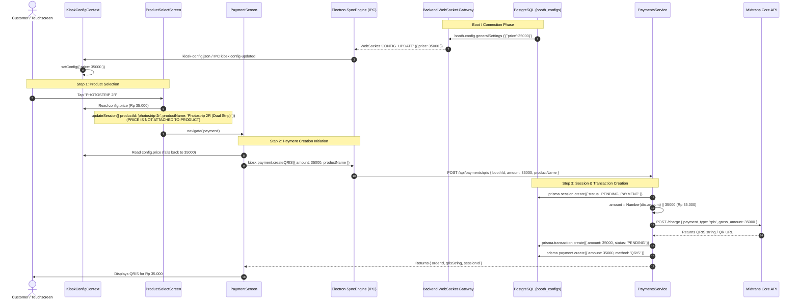

# Payment Amount Source of Truth Audit

**Document ID:** `PAYMENT_AMOUNT_SOURCE_AUDIT.md`  
**Date:** September 23, 2026  
**Auditor:** Antigravity AI  
**Scope:** Trace the exact source of truth for the Rp 35.000 QRIS payment amount across Kiosk, Backend, Database, Dashboard, and Midtrans.  
**Constraint:** Audit only. No code modified. No pricing changed.

---

## 1. Executive Summary: Core Answers to Founder Questions

| # | Question | Direct Answer | Technical Details |
|:---|:---|:---:|:---|
| **1** | **Where does Rp 35.000 come from?** | **Booth General Settings (`generalSettings.price`)** | It is defined as a booth-level setting: `generalSettings = '{"price":35000,...}'`. Loaded via KioskConfig context (`config.price`), sent via IPC to `SyncEngine`, and submitted to backend `/api/payments/qris`. |
| **2** | **Is it product-based?** | **NO** | There is **no product catalog or product pricing table** anywhere in the database schema or code. Selecting "Photostrip 2R" only sets aesthetic metadata (`productId`, `productName`, `frameId`), but **does not dictate the price**. |
| **3** | **Is it database-driven?** | **YES (Architecturally)** | Stored in PostgreSQL table `booth_configs`, column `generalSettings` with database schema default `'{"price":35000,"countdown":5,"timeout":270}'`. |
| **4** | **Is it dashboard configurable?** | **API: YES<br>UI: NO (Not yet exposed)** | The backend API has full endpoints (`POST /api/booths/push-config` and `PATCH /api/booths/:id/config`) and WebSocket sync (`CONFIG_UPDATE`) to push new prices live. However, the current React Dashboard (`apps/dashboard`) has **no input field or UI form** to change this setting. |
| **5** | **Is it hardcoded?** | **YES (As Fallbacks/Defaults)** | Because local/seeded database records often store empty objects `"{}"`, `35000` is hardcoded as an emergency default fallback in **9 separate locations** across frontend, backend, schemas, and IPC. |

---

## 2. End-to-End Execution Trace



---

## 3. Detailed Trace Step-by-Step

### Phase 1: Product Selection Screen
**File:** [`apps/kiosk/src/screens/ProductSelectScreen.tsx`](file:///c:/Users/ezarh/.gemini/antigravity-ide/scratch/Pictolabs/pictolabs-rebuild/apps/kiosk/src/screens/ProductSelectScreen.tsx)

```typescript
// Line 8 & 11:
const { config } = useKioskConfig();
const priceFormatted = (config.price || 35000).toLocaleString('id-ID');

// Line 13-20:
const handleContinue = () => {
  updateSession({
    productId: 'photostrip-2r',
    productName: 'Photostrip 2R (Dual Strip)',
    frameId: '2R', // Standard 2R strip identifier
  });
  navigate('payment');
};
```
- **What happens:** The screen reads the price from `config.price` to display `Rp 35.000` on the badge.
- **Critical finding:** When the user clicks "Lanjutkan", the `handleContinue` function **does NOT set a price** on the session. It only records `productId`, `productName`, and `frameId`.
- **Verdict:** Pricing is **completely detached** from the product selected.

---

### Phase 2: Session & Payment Initiation
**File:** [`apps/kiosk/src/screens/PaymentScreen.tsx`](file:///c:/Users/ezarh/.gemini/antigravity-ide/scratch/Pictolabs/pictolabs-rebuild/apps/kiosk/src/screens/PaymentScreen.tsx)

```typescript
// Line 26-29:
const { config } = useKioskConfig();
const price = config.price || 35000;
const priceFormatted = price.toLocaleString('id-ID');

// Line 123-128:
const res = await kiosk.payment.createQRIS({
  amount: price,
  productName: sessionRef.current.productName || sessionRef.current.frameName || 'Photostrip 2R',
});
```
- **What happens:** `PaymentScreen` extracts `config.price` (or 35000 fallback).
- It passes `amount: price` (35000) directly to the Electron IPC bridge `kiosk.payment.createQRIS`.

---

### Phase 3: Electron IPC Bridge & HTTP Forwarding
**File:** [`apps/kiosk/electron/services/SyncEngine.ts`](file:///c:/Users/ezarh/.gemini/antigravity-ide/scratch/Pictolabs/pictolabs-rebuild/apps/kiosk/electron/services/SyncEngine.ts)

```typescript
// Line 1231-1256:
ipcMain.handle('payment:create-qris', async (_event, params: { ... amount?: number; ... }) => {
  const baseUrl = config.apiBaseUrl || 'http://localhost:4000';
  const boothId = params.boothId || config.boothId || config.deviceSecret || 'dev-secret-booth-01';
  
  const res = await fetch(`${baseUrl}/api/payments/qris`, {
    method: 'POST',
    headers: { 'Content-Type': 'application/json' },
    body: JSON.stringify({
      boothId,
      sessionId: params.sessionId,
      amount: params.amount || 35000,
      productName: params.productName,
      voucherCode: params.voucherCode,
    }),
  });
  return await res.json();
});
```
- **What happens:** `SyncEngine` sends an HTTP POST request to the backend `/api/payments/qris` carrying `amount: 35000`.

---

### Phase 4: Backend Payment Service & Midtrans Core API
**File:** [`apps/backend/src/payments/payments.service.ts`](file:///c:/Users/ezarh/.gemini/antigravity-ide/scratch/Pictolabs/pictolabs-rebuild/apps/backend/src/payments/payments.service.ts)

```typescript
// Line 100-112:
if (!session) {
  const newSessionId = dto.sessionId || `session_${Date.now()}_${Math.random().toString(36).slice(2, 8)}`;
  session = await this.prisma.session.create({
    data: {
      id: newSessionId,
      boothId: booth.id,
      status: 'PENDING_PAYMENT',
    },
  });
}

const orderId = this.generateOrderId(booth.id);
let amount = Number(dto.amount) || 35000;

// Line 139-150: Midtrans Charge Payload
const chargePayload = {
  payment_type: 'qris',
  transaction_details: {
    order_id: orderId,
    gross_amount: Math.round(amount), // -> 35000
  },
  qris: {
    acquirer: 'gopay',
  },
  custom_field1: booth.id,
  custom_field2: session.id,
};

const response = await fetch(`${this.apiUrl}/charge`, {
  method: 'POST',
  headers: {
    'Content-Type': 'application/json',
    'Accept': 'application/json',
    'Authorization': authHeader,
  },
  body: JSON.stringify(chargePayload),
});
```
- **What happens:**
  1. The backend creates a new `Session` record in the database with status `PENDING_PAYMENT`.
  2. It sanitizes the amount: `let amount = Number(dto.amount) || 35000`.
  3. It sends `gross_amount: 35000` to Midtrans `/charge` endpoint.
  4. Midtrans issues the dynamic QRIS code for exactly Rp 35.000.
  5. The backend records a `Transaction` row and a `Payment` row in PostgreSQL with `amount: 35000`.

---

## 4. In-Depth Analysis of the 5 Specific Questions

### Question 1: Where does Rp 35.000 come from?
The price comes from the **Kiosk Configuration Context**, which is fed by **three tiers**:
1. **Tier 1 (Cloud Push / WebSocket):** The backend reads `booth_configs.generalSettings` from PostgreSQL and emits `CONFIG_UPDATE` over WebSocket upon kiosk connection.
2. **Tier 2 (Local Cache):** Electron saves the configuration to `%APPDATA%\@pictolabs\kiosk\pictolabs-data\kiosk-config.json`.
3. **Tier 3 (Default Fallback):** If `kiosk-config.json` is empty `{}` or the database setting is unpopulated, `KioskConfigContext.tsx` defaults to `DEFAULT_KIOSK_CONFIG.price = 35000`.

---

### Question 2: Is it product-based?
**NO.**
- In the entire codebase and Prisma database schema, there is **no table for products** and **no price column on any product model**.
- The Prisma schema has tables for `Booth`, `BoothConfig`, `Session`, `Photo`, `Print`, `Frame`, `FrameLayer`, `FrameAsset`, `Transaction`, `Payment`, `Voucher`, and `Device`.
- When a customer taps a product on `ProductSelectScreen`, it only changes the label in the session state. It does not look up a price catalog.
- The pricing model is currently **flat per-booth admission** (a single rate configured for the booth regardless of photos taken or product selected).

---

### Question 3: Is it database-driven?
**YES (by design and schema).**
- In PostgreSQL (`apps/backend/prisma/schema.prisma`, line 119–130):
  ```prisma
  model BoothConfig {
    id              String   @id @default(uuid())
    boothId         String   @unique
    booth           Booth    @relation(fields: [boothId], references: [id])
    cameraSettings  String   @default("{\"iso\":100,\"shutterSpeed\":\"1/125\",\"aperture\":\"f/5.6\"}")
    printerSettings String   @default("{\"paperSize\":\"4R\",\"copies\":1,\"offsetX\":0,\"offsetY\":0}")
    generalSettings String   @default("{\"price\":35000,\"countdown\":5,\"timeout\":270}")
    createdAt       DateTime @default(now())
    updatedAt       DateTime @updatedAt

    @@map("booth_configs")
  }
  ```
- In PostgreSQL Migration (`20260909000000_init_postgresql/migration.sql`, line 59):
  ```sql
  "generalSettings" TEXT NOT NULL DEFAULT '{"price":35000,"countdown":5,"timeout":270}',
  ```
- When a booth connects via WebSocket (`apps/backend/src/gateway/kiosk.gateway.ts`, line 81–89):
  ```typescript
  if (booth.config?.generalSettings) {
    try {
      const general = JSON.parse(booth.config.generalSettings);
      client.emit('CONFIG_UPDATE', general);
    } catch {
      client.emit('CONFIG_UPDATE', booth.config);
    }
  }
  ```
- **However, in developer / initial seed environments:** `apps/backend/seed.js` created `boothConfig` with `generalSettings: "{}"` (empty JSON). Because it was seeded with an empty object, the database value has no `price` property, forcing the system to rely on its default fallbacks.

---

### Question 4: Is it dashboard configurable?
**Status: Backend API Ready, but Dashboard UI NOT YET IMPLEMENTED.**

1. **Backend Infrastructure (Ready):**
   - The backend already exposes two endpoints in [`BoothsController.ts`](file:///c:/Users/ezarh/.gemini/antigravity-ide/scratch/Pictolabs/pictolabs-rebuild/apps/backend/src/booths/booths.controller.ts) (lines 110–144):
     - `PATCH /api/booths/:id/config`: Updates configuration in database and pushes live update.
     - `POST /api/booths/push-config`: Broadcasts a config payload (e.g. `{ "price": 45000 }`) to all booths or a specific booth via WebSocket and updates the database.
   - If a Superadmin sends `{ "price": 50000 }` to `POST /api/booths/push-config`, live kiosks **immediately update their price on screen and in Midtrans transactions without restarting**.

2. **Dashboard Web App UI (`apps/dashboard`):**
   - In [`BoothDetailDrawer.tsx`](file:///c:/Users/ezarh/.gemini/antigravity-ide/scratch/Pictolabs/pictolabs-rebuild/apps/dashboard/src/components/booths/BoothDetailDrawer.tsx), the drawer currently only supports:
     - Operational Status & Maintenance Toggle
     - Hardware Provisioning & Pairing Token
     - 6-Digit Technician Admin PIN update
     - 5-Pillar Health Diagnostics
     - Runtime specs & Heartbeat age
   - **There is currently NO input field, slider, or form control in the dashboard UI to view or edit the booth price.**

---

### Question 5: Is it hardcoded?
**YES, as fallback defaults in 9 distinct files:**

| # | File Path | Line | Code Snippet |
|:---|:---|:---:|:---|
| 1 | `apps/backend/prisma/schema.prisma` | 125 | `generalSettings String @default("{\"price\":35000,...}")` |
| 2 | `apps/backend/prisma/migrations/...` | 59 | `DEFAULT '{"price":35000,"countdown":5,"timeout":270}'` |
| 3 | `packages/shared/src/schemas.ts` | 18 | `price: z.number().min(0).default(35000)` |
| 4 | `apps/kiosk/src/context/KioskConfigContext.tsx` | 22 | `DEFAULT_KIOSK_CONFIG = { price: 35000, ... }` |
| 5 | `apps/kiosk/src/screens/ProductSelectScreen.tsx`| 11 | `const priceFormatted = (config.price \|\| 35000)...` |
| 6 | `apps/kiosk/src/screens/FrameSelectScreen.tsx` | 64 | `Rp {(config.price \|\| 35000).toLocaleString('id-ID')}` |
| 7 | `apps/kiosk/src/screens/PaymentScreen.tsx` | 28 | `const price = config.price \|\| 35000;` |
| 8 | `apps/kiosk/electron/services/SyncEngine.ts` | 1252 | `amount: params.amount \|\| 35000` |
| 9 | `apps/backend/src/payments/payments.service.ts` | 112 | `let amount = Number(dto.amount) \|\| 35000;` |

---

## 5. Architectural Summary & Recommendations for Founder

### Current State
1. The system operates on a **Single Flat-Fee Booth Model**: All photo sessions at a given booth cost the same amount.
2. The current active amount is **Rp 35.000**.
3. Because the local database / seed config is currently `{}` (empty), the system is running on its **coded defaults of 35000**.
4. The cloud push mechanism (`kiosk.gateway.ts` → `SyncEngine.ts` → `KioskConfigContext.tsx`) is already fully built and functional over WebSockets.

### How to Change Pricing in the Future (When Authorized)
- **Option A (Instant Backend Push):** Call `POST /api/booths/push-config` with payload `{ "price": <NEW_AMOUNT> }`. This persists the new amount in `booth_configs` and instantly updates live kiosks over WebSocket without app rebuilds or restarts.
- **Option B (Dashboard UI Feature):** Add a "Pricing & Session Duration" card to `BoothDetailDrawer.tsx` in `apps/dashboard` so non-technical operators can change pricing directly from the web admin.
- **Option C (Multi-Product Pricing):** If different products (e.g. Photostrip 2R vs Postcard 4R) should have different prices, a `products` catalog table and product-to-price mapping must be added to the database and session pipeline.
