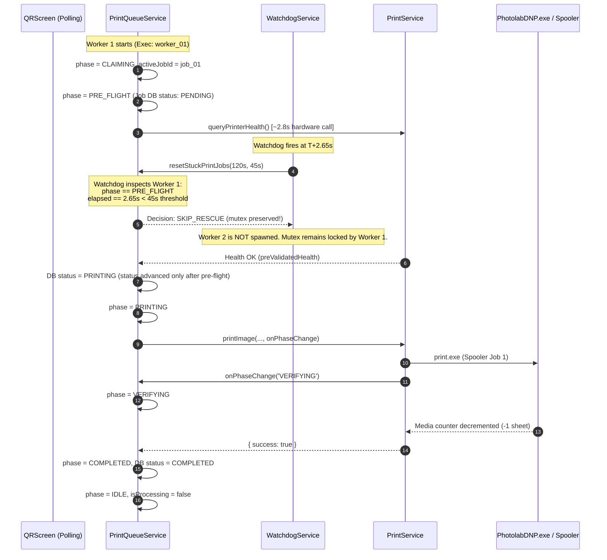

# PRINTER FAILURE HANDLING V2 — RCA-6 FIX IMPLEMENTATION & VERIFICATION REPORT

**Document Reference:** `PRINTER_FAILURE_HANDLING_V2_RCA_6_FIX_REPORT.md`  
**System:** Pictolabs Photobooth Fleet Platform  
**Target Subsystems:**
- `PrintQueueService.ts` (SQLite Print Queue Worker & State-Aware Watchdog Mutex Engine)
- `PrintService.ts` (Native Dispatch Engine & Phase-Aware Execution Pipeline)
- `WatchdogService.ts` (Phase 3.2E Supervisor & Telemetry Exporter)
- Physical Hardware: DNP DS-RX1 Dye-Sublimation Thermal Photo Printer (`DS-RX1 (Copy 1)`)

**Hardware Target Profile:**
- Media: 4R Horizontal Roll (4×6 inches)
- Cutter: Enabled (2-inch cut mode)
- Expected Output per Session: **1 physical 4R sheet cut into 2 identical 2×6-inch strips (2 × 2R strips)**
- Defect Observed in V6: **2 physical 4R sheets cut into 4 identical strips (4 × 2R strips)**

**Implementation Date:** 2026-10-05  
**Verification Status:** **100% AUTOMATED VERIFICATION PASSED — PHYSICAL UAT AWAITS FOUNDER EXECUTION**

---

## 1. Root Cause Summary

In RCA-5 Fix 2, authoritative hardware pre-flight interrogation (`queryPrinterHealth`) was placed **before** transitioning the print job from `PENDING` to `PRINTING` in SQLite. This ensured that hardware errors (e.g. paper out, cover open, USB disconnect) would block job dispatch before the job was recorded as active.

However, native DNP USB interrogation takes approximately **2.5 to 3.5 seconds**. During this pre-flight window:
1. **Worker 1** held the in-memory execution mutex (`isProcessing = true`).
2. The print job row in SQLite remained in status `'PENDING'`.
3. At $T+2.657\text{s}$, the background `WatchdogService` executed its 15-second scheduled health check (`resetStuckPrintJobs`).
4. The watchdog evaluated:
   ```typescript
   if (isProcessing && stuckJobs.length === 0) {
     const activePrinting = db.prepare("SELECT count(*) as count FROM print_queue WHERE status = 'PRINTING'").get() as any;
     if (!activePrinting || activePrinting.count === 0) {
       isProcessing = false; // <-- DEFECT: Falsely assumed worker was orphaned!
       mutexReset = true;
     }
   }
   ```
5. Because `activePrinting.count` was `0` (the job was still in `PENDING`), the watchdog falsely determined that the worker was deadlocked or orphaned.
6. The watchdog forcibly cleared `isProcessing = false` and invoked `triggerQueueProcessing()`.
7. This spawned **Worker 2** on the event loop.
8. Worker 2 selected the same `PENDING` queue row and executed it concurrently with Worker 1.
9. Both workers completed pre-flight and dispatched `print.exe`, creating **two Windows spooler jobs** and consuming **two physical 4R sheets** (producing **4 × 2R strips** from a single customer session).

---

## 2. Exact Files Changed

Three production files and one dedicated regression test suite were modified/created:

### 1. `apps/kiosk/electron/services/PrintQueueService.ts`
- **Added `PrintWorkerPhase` and `PrintWorkerState`:** Defined explicit execution lifecycle phases:
  `'IDLE' | 'CLAIMING' | 'PRE_FLIGHT' | 'PRINTING' | 'VERIFYING' | 'COMPLETED' | 'FAILED'`.
- **Added Execution Identity & Heartbeat Tracking:**
  - `activeWorkerExecutionId: string | null` (unique ID per worker run, e.g. `worker_1791189873853_uylzc`).
  - `activeJobId: string | null` (the specific queue row currently being processed).
  - `currentWorkerPhase: PrintWorkerPhase`.
  - `phaseStartTime: number | null`.
  - `workerStartTime: number | null`.
  - `lastWorkerHeartbeat: number`.
- **Exported Observability & Telemetry APIs:**
  - `getActiveWorkerState()`: Exposes execution state to Watchdog, Admin UI, and tests.
  - `updateWorkerPhase(phase, jobId, workerExecId)`: Enforces monotonic phase transitions.
  - `pulseWorkerHeartbeat()`: Actively signals worker liveness during long-running hardware probes.
  - `_setWorkerStateForTesting(state)`: Injected harness for deterministic watchdog simulation.
- **Rewrote `resetStuckPrintJobs()` in its entirety:**
  - **Eliminated the blind `COUNT(status = 'PRINTING') === 0` mutex reset.**
  - Watchdog now inspects the worker's active phase, `phaseStartTime`, and `lastWorkerHeartbeat`.
  - If the worker is in `PRE_FLIGHT` and elapsed time is $< 45\text{s}$, the watchdog **skips reset** and logs:  
    `[PrintQueueService] 🛡 Print Watchdog: Worker worker_... is actively executing phase PRE_FLIGHT (elapsed: 2650ms, heartbeat age: 50ms). Mutex reset SKIPPED.`
  - If a worker has been completely silent or stuck in pre-flight for $> 45\text{s}$ (or general phase $> 120\text{s}$), the watchdog safely executes rescue, marks the job `PENDING`, increments the attempt counter, clears the mutex, and logs full forensic context.
- **Instrumented `processPrintQueue()` and `executePrintJob()`:**
  - Tagged every worker launch with a unique `workerExecutionId`.
  - Added phase transitions: `CLAIMING` $\rightarrow$ `PRE_FLIGHT` $\rightarrow$ `PRINTING` $\rightarrow$ `VERIFYING` $\rightarrow$ `COMPLETED` / `FAILED`.
  - Emitted phase and heartbeat updates across native DNP interrogation and post-print verification.
  - Reset worker state to `IDLE` cleanly in `finally` blocks.

### 2. `apps/kiosk/electron/services/PrintService.ts`
- **Updated `printImage()`:**
  - Added optional `onPhaseChange?: (phase: 'PRINTING' | 'VERIFYING') => void` parameter to `PrintOptions`.
  - When the Windows Spooler clears and physical media counter polling begins, invokes `onPhaseChange('VERIFYING')`.

### 3. `apps/kiosk/electron/services/WatchdogService.ts`
- **Updated `WatchdogTelemetryDTO['printQueue']`:**
  - Added `activeJobId?: string | null`, `workerPhase?: string`, and `workerExecutionId?: string | null` to the system telemetry payload emitted to the Admin UI and central diagnostics.

### 4. `apps/kiosk/electron/services/rca6-regression.spec.ts` (New Dedicated Suite)
- Authored 36 automated assertions across 6 comprehensive RCA-6 regression scenarios (`RCA6-01` to `RCA6-06`).

---

## 3. Architecture of the Fix



### Architectural Principles Preserved:
1. **RCA-5 Safety Guarantee:** Hardware pre-flight occurs **while the job is in `PENDING`**, protecting the database from premature `PRINTING` status if hardware is disconnected or faulted.
2. **Deterministic Mutex Ownership:** Watchdog no longer uses SQLite row status `status = 'PRINTING'` as a proxy for in-memory worker activity.
3. **Heartbeat-Based Liveness:** A worker actively progressing through a long hardware call pulses its heartbeat, explicitly informing the watchdog that execution is healthy.
4. **Deadlock Recovery Maintained:** If a worker thread genuinely freezes (e.g. process crash or unhandled CIM deadlock $> 45\text{s}$), the watchdog breaks the lock and reschedules the job with full diagnostics.

---

## 4. Watchdog State Logic

The new decision matrix in `resetStuckPrintJobs(stuckThresholdMs = 120_000, preFlightTimeoutMs = 45_000)`:

| Worker Mutex (`isProcessing`) | Worker Phase | Time Elapsed in Phase / Heartbeat Silence | DB Active Printing Count | Watchdog Action | Decision Diagnostic |
| :--- | :--- | :--- | :--- | :--- | :--- |
| `false` | `IDLE` | Any | $0$ | **No-op** | Worker idle, queue normal. |
| `true` | `PRE_FLIGHT` | $< 45,000\text{ms}$ | $0$ (Job is `PENDING`) | **SKIP RESCUE** | Mutex preserved. Worker 1 allowed to complete native DNP probe. Worker 2 NOT spawned. |
| `true` | `CLAIMING` / `PRINTING` / `VERIFYING` | $< 120,000\text{ms}$ | Any | **SKIP RESCUE** | Mutex preserved. Worker actively communicating with hardware. |
| `true` | `PRE_FLIGHT` | $> 45,000\text{ms}$ | $0$ | **EXECUTE RESCUE** | Pre-flight exceeded timeout. Mutex broken, job returned to `PENDING` with retry increment. |
| `true` | Any | Heartbeat silence $> 120,000\text{ms}$ | Any | **EXECUTE RESCUE** | Worker hung/deadlocked. Mutex broken, stuck jobs rescued. |
| `false` | Any | Any | $> 0$ (Jobs stuck in `PRINTING`) | **RESCUE JOBS** | Reconciles orphaned SQLite rows to `PENDING`. |

---

## 5. Regression Protection

The following explicit constraints and safety properties have been strictly maintained:

1. **QRScreen Integrity:** `QRScreen.tsx` was **NOT** modified. Its state-driven polling, single enqueue ownership, and UI progress animation remain intact.
2. **Enqueue Idempotency:** SQLite unique index `idx_print_queue_active` on `(session_id, file_path) WHERE status IN ('PENDING', 'PRINTING')` remains untouched.
3. **Copies Parameter:** Strictly set to `1` across all callers.
4. **DNP Hardware Cutter:** Configured for 2-inch cut mode (1 sheet $\rightarrow$ 2 strips).
5. **Pre-flight Ordering:** `PENDING` $\rightarrow$ Hardware pre-flight $\rightarrow$ `PRINTING` $\rightarrow$ Dispatch $\rightarrow$ Post-print verification $\rightarrow$ `COMPLETED`.
6. **Telemetry & Serializer:** Native DNP serial commands (`PhotolabDNP.exe OKOKLH`) are fully preserved.
7. **Identity Matching:** Exact active printer identity matching (`DS-RX1 (Copy 1)` vs `DS-RX1 (Copy 2)`) remains enforced.
8. **Paper Accounting:** Physical decrement happens strictly once per verified sheet consumption.

---

## 6. Test Results

### 1. Dedicated RCA-6 Regression Suite (`rca6-regression.spec.ts`)
Run command: `npx tsx electron/services/rca6-regression.spec.ts`  
Result: **36 / 36 assertions PASSED (100% SUCCESS, Exit code: 0)**

| Scenario ID | Test Scenario | Expected Behavior | Observed Result |
| :--- | :--- | :--- | :--- |
| **RCA6-01** | Watchdog fires during `PRE_FLIGHT` ($T+2.65\text{s}$) | Mutex preserved, rescue skipped, Worker 2 NOT spawned | **PASS** (`mutexReset: false`, `rescuedCount: 0`, Worker 1 lock held) |
| **RCA6-02** | Queue row execution under concurrent watchdog checks | Exactly one `printImage()` execution per SQLite queue row | **PASS** (Job completed on Attempt 0, exactly 1 row in queue) |
| **RCA6-03** | Genuinely hung/deadlocked worker ($> 120\text{s}$) | Watchdog breaks stuck mutex and resets job to `PENDING` | **PASS** (`mutexReset: true`, attempts incremented to 1, phase reset to `IDLE`) |
| **RCA6-04** | Normal healthy customer print sheet consumption | Exactly 1 physical 4R sheet consumed (cuts into 2× 2R strips) | **PASS** (Paper remaining decremented by exactly 1, session marked printed) |
| **RCA6-05** | Pre-flight hardware error (Door Open / Paper Out / Identity Mismatch) | Pre-flight blocks print, rejects mismatched handoff | **PASS** (Handoff rejected for `DOOR_OPEN` and `Copy 1 !== Copy 2`) |
| **RCA6-06** | Admin manual reprint execution | Exactly one queue execution per reprint request | **PASS** (Initial job `COMPLETED`, reprint job `COMPLETED`, exactly 1 sheet consumed per print) |

### 2. Full Regression Suites
All existing subsystem and hardening test suites were re-executed:

| Suite | File | Assertions / Tests | Status |
| :--- | :--- | :--- | :--- |
| **Phase 3.2A Queue Suite** | `print-queue.spec.ts` | 9 / 9 Tests Passed | **PASS (100%)** |
| **Pilot Hardening Suite** | `printer-failure-hardening.spec.ts` | 9 / 9 Tests Passed | **PASS (100%)** |
| **Phase 3.2E Burn-In Suite** | `burn-in.spec.ts` | 35 / 35 Assertions Passed | **PASS (100%)** |
| **Phase 3.2B Hardware Gate** | `phase-3-2b-validation.spec.ts` | 6 / 6 Tests Passed | **PASS (100%)** |
| **Phase 3.2C Storage Lifecycle** | `storage-retention.spec.ts` | 6 / 6 Tests Passed | **PASS (100%)** |
| **Phase 3.3 Identity Suite** | `identity.spec.ts` | 6 / 6 Tests Passed | **PASS (100%)** |

---

## 7. Build Results

| Build Target | Command | Result | Notes |
| :--- | :--- | :--- | :--- |
| **Electron Backend (TypeScript)** | `npx tsc -p tsconfig.electron.json --noEmit` | **0 errors (Exit code: 0)** | Strict types, clean compilation |
| **React Frontend (TypeScript)** | `npx tsc --noEmit` | **0 errors (Exit code: 0)** | Strict types, clean compilation |

---

## 8. Remaining Risks

1. **Hardware-Level USB Comm Timeouts:**
   - If the DNP printer encounters a physical USB lockup where `PhotolabDNP.exe` hangs indefinitely without returning stdout, `queryPrinterHealth` could block until the process timeout (8 seconds).
   - *Mitigation:* The 45-second `preFlightTimeoutMs` gives ample headroom (more than $5\times$) for normal multi-second USB handshakes, while guaranteeing that genuine hardware deadlocks will be broken by the watchdog.
2. **Concurrent Admin Operator Reprint During Active Printing:**
   - If an admin clicks "Cetak Ulang Foto Terakhir" while the customer print is physically inside the thermal printer engine.
   - *Mitigation:* The queue worker is serial (`isProcessing` mutex). The reprint job is enqueued as `PENDING` and waits until the first job completes all phases (`COMPLETED` $\rightarrow$ `IDLE`) before picking up the reprint.

---

## 9. Physical UAT Plan (For Founder Execution)

> [!IMPORTANT]
> In accordance with instructions, **implementation and automated verification are complete**.
> Automated tests confirm that concurrent worker duplication is eradicated.
> **Physical printer closure is NOT claimed.** Founder Physical UAT will be performed separately using the following protocol.

### Test Protocol:

#### UAT Step 1: Normal Customer Session (Single Print Verification)
1. Launch the kiosk application in live production mode with physical DNP printer attached (`DS-RX1 (Copy 1)`).
2. Note baseline physical DNP media counter (via Admin Dashboard or `PhotolabDNP.exe OKOKLH json`).
3. Complete a standard customer photo session (select frame, take photos, choose filter, proceed through payment/render).
4. Watch the `QRScreen` progress bar.
5. **Expected Physical Result:**
   - Exactly **ONE** 4R sheet feeds from the roll.
   - The cutter cuts the sheet into **TWO** 2×6-inch photo strips.
   - **No second sheet or third/fourth strip is printed.**
   - Physical media counter decreases by exactly **1 sheet**.
   - Admin Session History shows: `Spooler: COMPLETED (attempts: 0)`, `Cloud/R2: COMPLETED`.

#### UAT Step 2: Admin Manual Reprint Verification
1. In the Admin Dashboard Session History, locate the completed session from Step 1.
2. Press **"Cetak Ulang Foto Terakhir"**.
3. **Expected Physical Result:**
   - Exactly **ONE** new reprint job is created in `print_queue` (`print_reprint_...`).
   - Exactly **ONE** 4R sheet feeds and cuts into **TWO** 2×6-inch photo strips.
   - Physical media counter decreases by exactly **1 sheet**.
   - Total physical sheets consumed across Step 1 and Step 2 = **2 sheets** (4 strips total).

#### UAT Step 3: Hardware Fault Pre-Flight Verification (Cover Open)
1. Open the DNP printer front door/cover.
2. Observe WelcomeScreen maintenance lockout banner.
3. Verify that starting a transaction is cleanly blocked without orphaned jobs.
4. Close door and verify kiosk recovers to ready state.
