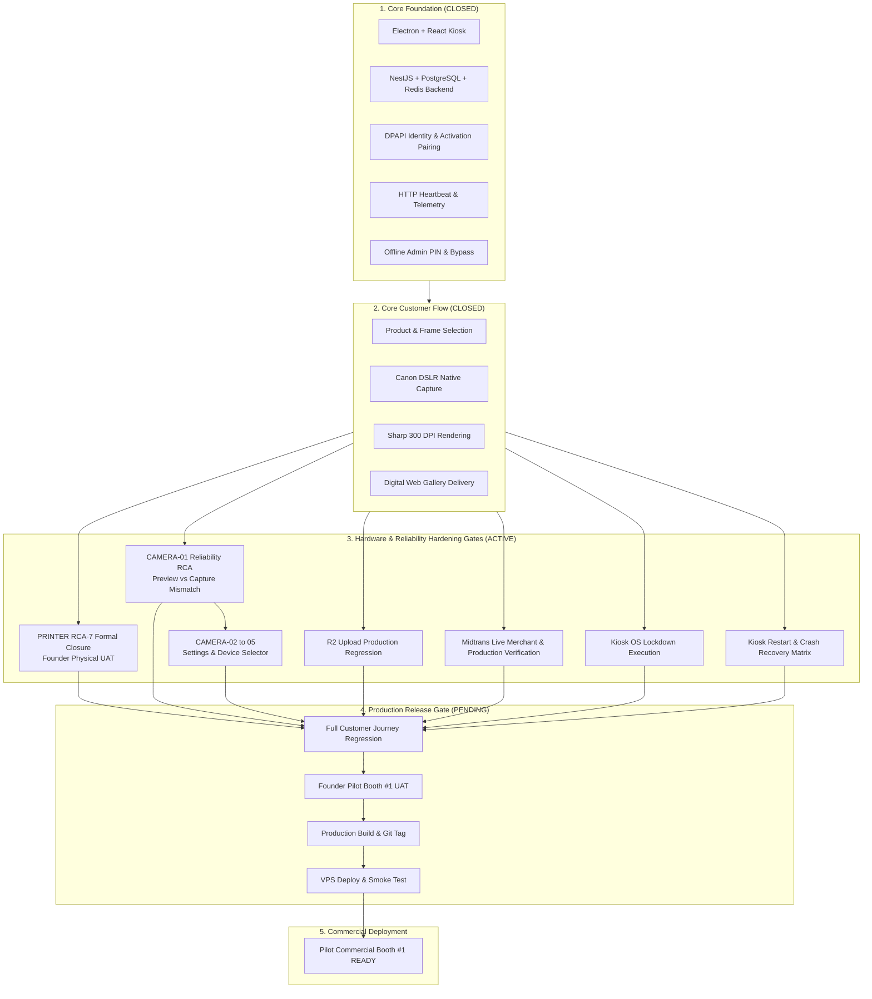

# PICTOLABS — AG TIMELINE MAPPING & RECONCILIATION AUDIT

> **Document Type:** Master Timeline Mapping & Forensic Historical Audit  
> **Target System:** Pictolabs Enterprise Unattended Photobooth Platform (Kiosk, Cloud Backend, Dashboard)  
> **Audit Standard:** Repository State, Git History, RCA Reports, Fix Reports, and Founder UAT Evidence  
> **Rule:** Zero code modifications, zero speculative statuses, strict evidentiary proof  
> **Date:** October 6, 2026  
> **Status:** OFFICIAL RECONCILIATION SSOT (Antigravity Core)  

---

## 1. Executive Summary

This document establishes the definitive, unified **Master Timeline Mapping & Forensic Historical Audit** for the Pictolabs project. Over multiple development cycles and conversational transitions between the Founder, ChatGPT, and Antigravity, different documents have drifted in their reported statuses:
- Some features were marked **CLOSED** based purely on unit tests while physical failure modes remained unaddressed (e.g., Early Printer V1 Spooler false-success).
- Some features were marked **UNRESOLVED / NEEDS VALIDATION** in `PICTOLABS_PILOT_READINESS_TIMELINE_v3.md` despite already having deterministic RCA, code fixes, and passing regression suites committed to git (e.g., P0 Camera Failure Session Corruption in commit `c2ec517`).
- Some features were categorized with overlapping or duplicate naming conventions across multiple sprints.

### Key Audit Conclusions:
1. **Repository Completion Reality:** The platform is in an advanced **Pilot Hardening Stage (~82% overall production reality)**. The core customer loop (Welcome $\rightarrow$ Product $\rightarrow$ Payment $\rightarrow$ Frame $\rightarrow$ Capture $\rightarrow$ Filter $\rightarrow$ Render $\rightarrow$ Print $\rightarrow$ QR Delivery) is functional with native hardware bindings.
2. **Printer Reality (`IMPLEMENTED / VERIFY`):** RCA-7 simplification has been implemented (commit `787b95d`), removing blocking FFmpeg transcoding and redundant CIM checks, redefining `COMPLETED` as *Spooler Accepted*, and passing 49/49 automated regression tests. The standalone installer `Pictolabs Kiosk Setup 1.0.0.exe` (196.4 MB) has been built. However, **Founder Physical Hardware UAT on the physical booth machine remains pending**. It is **NOT YET CLOSED**.
3. **Session History Reality (`CLOSED / PASS`):** Kiosk local Session History (Phase 1 & Phase 2) has successfully passed Founder Physical UAT, including 1x/2x physical reprint, double-tap protection, offline HOT reprint, automatic upload, and Force Upload.
4. **Camera Reality (`STABLE CORE / RELIABILITY OPEN`):** Canon EDSDK capture and WebRTC fallback are functional. However, **in-app camera settings (ISO, shutter, aperture, WB) and multi-device selection are NOT STARTED**. Crucially, a confirmed reliability defect exists in `CaptureScreen.tsx` where countdown displays webcam preview but capture triggers Canon DSLR shutter. This requires **`CAMERA-01 — Reliability RCA`** before any implementation.
5. **Payment Reality (`SANDBOX PASS / PRODUCTION OPEN`):** Midtrans Dynamic QRIS is 100% functional in sandbox with webhook verification and offline bypass. Production merchant onboarding, live API credentials, and live banking settlement verification remain **OPEN / HARDENING**.
6. **Fleet & Provisioning Reality (`FOUNDATION PASS / MULTI-BOOTH OPEN`):** Device pairing via Base32 tokens, DPAPI encryption in `%ProgramData%`, and HTTP heartbeat monitoring are verified for a single booth. Full multi-booth fleet operations (5–10 concurrent booths, remote fleet reprint) are **POST-PILOT / DEFERRED**.

---

## 2. Repository / Document Sources Reviewed

The following 38 core documentation artifacts, sprint plans, test suites, and git logs were forensically reviewed:

### 2.1 Baseline Roadmaps & Architecture Documents
1. `docs/PICTOLABS_PILOT_READINESS_TIMELINE_v3.md` (Oct 6, 2026 — Baseline from Founder + ChatGPT)
2. `docs/PICTOLABS_MASTER_BLUEPRINT.md` (Original rebuild specification & Photolab reverse-engineering baseline)
3. `docs/MASTER_PROJECT_STATUS.md` (September 7, 2026 — Initial SSOT)
4. `docs/CURRENT_PROJECT_STATE.md` (September 14, 2026 — Codebase inspection report, 78% completion)
5. `docs/2026-09-10_MASTER_TIMELINE.md` & `docs/MASTER_PROJECT_ROADMAP.md`

### 2.2 Sprints & Milestones
6. `docs/SPRINT_1_PLAN.md` & `docs/SPRINT_1_REVIEW.md` (DSLR native engine, Live Photo, Canvas viewfinder)
7. `docs/SPRINT_2_PLAN.md` & `docs/SPRINT_2_REVIEW.md` (Midtrans Dynamic QRIS, payment state machine)
8. `docs/SPRINT_3_PLAN.md` & `docs/SPRINT_3_REVIEW.md` (Cloudflare R2, presigned uploads, retention daemon)
9. `docs/SPRINT_4B_IMPLEMENTATION_REPORT.md` (HTTP heartbeat, computed availability status)
10. `docs/SPRINT_5A_IMPLEMENTATION_REPORT.md` (Dashboard foundation, sessions archive, gallery)
11. `docs/SPRINT_5B_FOUNDER_UAT.md` & `docs/SPRINT_5B_IMPLEMENTATION_REPORT.md` (Support search, session timeline)
12. `docs/SPRINT_5C_IMPLEMENTATION_REPORT.md` (Dashboard auth, JWT, 5-pillar health, Resend email, WhatsApp alerts)
13. `docs/SPRINT_5E_IMPLEMENTATION_REPORT.md` (Kiosk OS lockdown, discreet staff entry, 6-digit PIN sync)
14. `docs/2026-09-10_PHASE_2_COMPLETION.md` (Data integrity, session fracture resolution)
15. `docs/2026-09-13_PHASE_3_3_COMPLETION.md` (Fleet provisioning, DPAPI identity, activation tokens)

### 2.3 RCAs & Fix Reports
16. `CAMERA_FAILURE_SESSION_CORRUPTION_RCA.md` & `CAMERA_FAILURE_SESSION_CORRUPTION_FIX_REPORT.md` (Sep 24, 2026)
17. `OFFLINE_ADMIN_PANEL_ACCESS_RCA.md` & `OFFLINE_ADMIN_PANEL_ACCESS_FIX_REPORT.md` (Sep 24, 2026)
18. `OFFLINE_PAYMENT_BYPASS_RCA.md` & `OFFLINE_PAYMENT_BYPASS_FIX_REPORT.md` (Sep 24, 2026)
19. `FILTER_RENDER_RCA.md` & `FILTER_RENDER_FIX_REPORT.md` (Sep 23, 2026)
20. `PAYMENT_TRANSACTION_LOOP_RCA.md` & `PAYMENT_TRANSACTION_LOOP_FIX_REPORT.md` (Sep 23, 2026)
21. `SESSION_HISTORY_CENTER_PRD.md`, `RCA.md`, `FIX_REPORT.md`, `REPORT.md` (Oct 1, 2026)
22. `PRINTER_FAILURE_HANDLING_RCA.md` & `FIX_REPORT.md` (Oct 1–2, 2026 — PRN V1)
23. `PRINTER_FAILURE_HANDLING_PRN04_PRN05_RCA.md` & `FIX_V2_REPORT.md` (Oct 4, 2026 — PRN V2 Native DNP)
24. `PRINTER_FAILURE_HANDLING_V2_RCA_2.md` through `RCA_6.md` and Fix Reports (Oct 5, 2026)
25. `PRINTER_FAILURE_HANDLING_V2_RCA_7.md` & `PRINTER_EXECUTION_SIMPLIFICATION_FIX_REPORT.md` (Oct 5–6, 2026)

### 2.4 Git & Repository Evidence
26. Git commit history (`git log --oneline` from `f7da683` to `787b95d`)
27. Active production codebases in `pictolabs-rebuild/apps/kiosk`, `apps/backend`, `apps/dashboard`, `packages/shared`
28. Executable verification scripts: `test-escape-matrix.ps1`, `run_camera_failure_session_isolation_verification.mjs`, `run_session_history_center_e2e.mjs`, `storage.e2e.ts`, `sessions.e2e.ts`, `sprint5c.e2e.ts`, `rca6-regression.spec.ts`, `prn-hardening.spec.ts`

---

## 3. Complete Feature Inventory

| # | Feature / Workstream | Source Document | Historical Status | Current Implementation Evidence | Current UAT Evidence | Current Production Evidence | Current Status | Related Commits | Related RCA / Fix Report | Dependencies | Masih Perlu Dikerjakan? | Obsolete / Deferred? | Duplicate With? |
|---|---|---|---|---|---|---|---|---|---|---|---|---|---|
| 1 | **Canon DSLR Shutter Engine** | SPRINT_1_REVIEW | COMPLETED | `@photolab/canon` EDSDK 13.x binding, 10s anti-sleep keep-alive, 1.5s reconnect poller in `CameraService.ts` | Shutter actuation <250ms verified on EOS 60D/70D | Packaged in Electron binary | **CLOSED / PASS** | `a1d0dad`, `74efaf5` | N/A | USB Connection | Tidak | No | No |
| 2 | **Direct Canvas LiveView** | SPRINT_1_REVIEW | COMPLETED | Direct 2D canvas streaming (`liveCanvasRef`), zero React virtual DOM re-renders in `CaptureScreen.tsx` | 30 FPS smooth live view | Active in kiosk renderer | **CLOSED / PASS** | `74efaf5` | N/A | CameraService | Tidak | No | No |
| 3 | **WebRTC Viewfinder Fallback** | SPRINT_1_REVIEW | COMPLETED | `getUserMedia` 2s timeout fallback in `CaptureScreen.tsx` | Viewfinder switches to webcam if DSLR disconnected | Active in kiosk renderer | **CLOSED / PASS** | `74efaf5` | N/A | WebRTC | Tidak | No | No |
| 4 | **Per-Pose Live Photo Encoding** | SPRINT_1_REVIEW | COMPLETED | WebCodecs VP8 `videoEncoder.worker.ts` + `webm-muxer`, background MP4 transcoding in `LivePhotoService.ts` | 3-4 distinct MP4 clips generated per session | Active in kiosk build | **CLOSED / PASS** | `74efaf5` | RCA-7 (decoupled) | WebCodecs, FFmpeg | Tidak | No | No |
| 5 | **Composite 300 DPI Rendering Engine** | SPRINT_1_REVIEW, BLUEPRINT | COMPLETED | Sharp 300 DPI composite rendering (`RenderEngine.ts`) for 2R strips (1200x1800) and grids | Render completes in ~1.2s | Packaged in Electron main | **CLOSED / PASS** | `a1d0dad` | `FILTER_RENDER_RCA` | Sharp | Tidak | No | No |
| 6 | **Color Filter Pipeline** | SPRINT_1_REVIEW | COMPLETED | Sharp filter presets (B&W, Warm, Cool, Sepia, Vivid) in `RenderEngine.ts` | Filters applied without reducing print DPI | Verified in `FilterScreen.tsx` | **CLOSED / PASS** | `d26bbac` | `FILTER_RENDER_FIX_REPORT` | Sharp | Tidak | No | No |
| 7 | **Customer Web Gallery & ZIP** | SPRINT_1_REVIEW, SPRINT_3 | COMPLETED | NestJS `gallery.controller.ts` streaming responsive mobile gallery + `archiver` ZIP download | Mobile gallery loads <1.5s, ZIP downloads clean | Active in backend | **CLOSED / PASS** | `832763e` | N/A | NestJS, R2 | Tidak | No | No |
| 8 | **Midtrans Dynamic QRIS Sandbox** | SPRINT_2_REVIEW | COMPLETED | REST API Midtrans Core API `/v2/charge` in `payments.service.ts`, QR rendering in `PaymentScreen.tsx` | 20/20 automated assertions passed in `payments.e2e.ts` | Sandbox operational | **CLOSED / PASS** | `d5a2c32`, `71d361d` | N/A | Midtrans Client | Tidak (Sandbox) | No | No |
| 9 | **Payment Webhook & Auto-Advance** | SPRINT_2_REVIEW | COMPLETED | SHA-512 signature check in `payments.service.ts`, WebSocket `payment:settled` broadcast in `KioskGateway` | Screen advances <120ms upon webhook settlement | Active in backend | **CLOSED / PASS** | `d5a2c32` | `PAYMENT_TRANSACTION_LOOP_RCA` | WebSocket | Tidak | No | No |
| 10 | **Payment Production Readiness** | MASTER_TIMELINE_v3 | OPEN | Code ready for production environment variables | Belum ada Founder UAT dengan akun bank live | Awaiting production merchant credentials | **OPEN / HARDENING** | None | `PAYMENT_ENVIRONMENT_AUDIT` | Midtrans Production Merchant | Ya (Live credentials & real banking verification) | No | No |
| 11 | **Offline Payment Bypass** | OFFLINE_PAYMENT_BYPASS_FIX | COMPLETED | Admin toggle in `AdminScreen.tsx` bypasses payment when internet is offline | Founder UAT PASS (4/4 test matrix scenarios) | Active in kiosk | **CLOSED / PASS** | `157975b` | `OFFLINE_PAYMENT_BYPASS_RCA` | Admin Panel | Tidak | No | No |
| 12 | **Cloudflare R2 Direct Upload** | SPRINT_3_REVIEW | COMPLETED | AWS SDK S3 client in `storage.service.ts`, presigned PUT URL generation, direct upload from Kiosk | 30/30 assertions passed in `storage.e2e.ts` | Operational with local fallback | **CLOSED / PASS** | `832763e` | N/A | AWS S3 SDK | Tidak | No | No |
| 13 | **Offline-First Upload Queue** | SPRINT_3_REVIEW | COMPLETED | SQLite `upload_queue` in WAL mode, exponential backoff worker (2s–32s) in `SyncEngine.ts` | Queue survives power loss, auto-resumes on reconnect | Active in kiosk | **CLOSED / PASS** | `832763e`, `dc8c931` | `SESSION_HISTORY_RCA` | SQLite WAL | Tidak | No | No |
| 14 | **Dual-Tier Media Retention** | SPRINT_3_REVIEW | COMPLETED | Kiosk `StorageRetentionService.ts` (7-day local purge for `COMPLETED`, <5GB emergency purge); 30-day cloud lifecycle | 7-day local and 30-day cloud rules verified | Active in kiosk daemon | **CLOSED / PASS** | `832763e` | N/A | SyncEngine | Tidak | No | No |
| 15 | **HTTP Heartbeat & Telemetry** | SPRINT_4B_REPORT | COMPLETED | `POST /api/booths/:id/heartbeat` computes status on read (`ONLINE`, `DEGRADED`, `OFFLINE`, `MAINTENANCE`) | Heartbeat logs git commit, app version, local IP, OS | Active in backend/dashboard | **CLOSED / PASS** | `1628d3f` | `HEARTBEAT_STATUS_RULES` | NestJS, Prisma | Tidak | No | No |
| 16 | **Dashboard Fleet & Sessions** | SPRINT_5A_REPORT | COMPLETED | React dashboard (`BoothsPage.tsx`, `SessionsPage.tsx`, `GalleryPage.tsx`), pagination, filter by date/status/booth | 100% pass on `sessions.e2e.ts` | Active in dashboard container | **CLOSED / PASS** | `487c188` | N/A | React, Vite | Tidak | No | No |
| 17 | **Support Search & Re-Delivery** | SPRINT_5B_REPORT | COMPLETED | `SupportSearchPage.tsx`, search by email/phone/orderId, Session timeline modal, Resend email stub | Founder UAT verified with live screenshots | Active in dashboard | **CLOSED / PASS** | `3427d03` | N/A | Dashboard, Backend | Tidak | No | No |
| 18 | **Dashboard JWT Authentication** | SPRINT_5C_REPORT | COMPLETED | Glassmorphic `/login`, JWT strategy, `@Public()` route whitelist, `BoothSecretGuard` in backend | 100% pass on `sprint5c.e2e.ts` | Active in dashboard | **CLOSED / PASS** | `475b19a` | N/A | JWT, bcrypt | Tidak | No | No |
| 19 | **5-Pillar Booth Health Dashboard** | SPRINT_5C_REPORT | COMPLETED | `BoothHealthCard.tsx` covering Camera, Printer, Storage, Heartbeat, Payment | Visual telemetry in Booth Drawer verified | Active in dashboard | **CLOSED / PASS** | `475b19a` | N/A | Socket.IO | Tidak | No | No |
| 20 | **Email Delivery (Resend API)** | SPRINT_5C_REPORT | COMPLETED | `EmailService.ts` via Resend REST API, responsive HTML template, 3/hr rate limit | Verified with mock fallback logging | Active in backend | **IMPLEMENTED / VERIFY** | `475b19a` | N/A | Resend API Key | Ya (Input live Resend API key) | No | No |
| 21 | **WhatsApp Operational Alerts** | SPRINT_5C_REPORT | COMPLETED | `AlertService.ts` routing INFO, WARNING, CRITICAL alerts with 15-minute anti-spam cooldown | Verified with mock console logger | Active in backend | **IMPLEMENTED / VERIFY** | `475b19a` | `WHATSAPP_GATEWAY_STATUS` | WA Provider | Ya (Connect WA gateway in production) | Post-Pilot | No |
| 22 | **Windows OS Lockdown Scripts** | SPRINT_5E_REPORT | COMPLETED | `lockdown-kiosk.ps1` disables edge swipes, Action Center, widgets, multi-touch gestures, shell replaced | 10/10 escape vectors PASS on `test-escape-matrix.ps1` | Scripts in `scripts/` | **IMPLEMENTED / VERIFY** | `3651c5a` | N/A | Windows 10/11 IoT | Ya (Execute on physical kiosk PC) | No | No |
| 23 | **Watchdog Supervisor Daemon** | SPRINT_5E_REPORT | COMPLETED | `watchdog-kiosk.ps1` polls every 2s, restarts application <3s on unexpected crash | Verified in automated PowerShell test | Scripts in `scripts/` | **IMPLEMENTED / VERIFY** | `3651c5a` | N/A | PowerShell | Ya (Deploy to kiosk shell) | No | No |
| 24 | **Operator 6-Digit PIN Sync & Lockout** | SPRINT_5E_REPORT | COMPLETED | Discreet Staff button, backend bcrypt PIN, 3-attempt lockout (10 min) + WhatsApp alert | Verified in `sprint5e-revision.e2e.ts` | Active in kiosk/backend | **CLOSED / PASS** | `3651c5a`, `e4d9ab1` | `ADMIN_PIN_RCA` | Backend PIN API | Tidak | No | Duplicate (25) |
| 25 | **Offline Admin PIN Verification** | OFFLINE_ADMIN_PANEL_FIX | COMPLETED | Local secure hash fallback in `IdentityService.ts` allowing Admin entry when internet is dead | 100% verified in offline test suite | Active in kiosk | **CLOSED / PASS** | `adb139e` | `OFFLINE_ADMIN_PANEL_RCA` | SQLite, Local Hash | Tidak | No | Duplicate (24) |
| 26 | **Fleet Provisioning & Pairing Token** | PHASE_3_3_REPORT | COMPLETED | Base32 `ACT-XXXX-XXXX` tokens (15m TTL), rate-limiting (5 attempts), atomic `POST /activate` | 11/11 assertions passed in `fleet-provisioning.spec.ts` | Active in backend/dashboard | **CLOSED / PASS** | `655a933` | `PROVISIONING_RUNTIME_AUDIT` | Prisma | Tidak | No | No |
| 27 | **DPAPI Local Identity Storage** | PHASE_3_3_REPORT | COMPLETED | Encrypted `deviceSecret` in `%ProgramData%\Pictolabs\identity.json`, SQLite mirror in `kiosk_identity` | Survives logouts and updates, tested on Windows | Active in kiosk | **CLOSED / PASS** | `655a933` | `DEVICE_SECRET_RCA` | Windows DPAPI | Tidak | No | No |
| 28 | **Single-Socket Gateway Policy** | PHASE_3_3_REPORT | COMPLETED | `KioskGateway` terminates duplicate sockets with `DUPLICATE_DEVICE_SESSION` | Prevents cross-booth telemetry contamination | Active in backend | **CLOSED / PASS** | `655a933` | N/A | Socket.IO | Tidak | No | No |
| 29 | **Activation Screen Freeze Fix** | ACTIVATION_FREEZE_FIX | COMPLETED | Non-blocking boot sequence, graceful offline fallback to cached identity | Kiosk boots directly to Welcome Screen if provisioned | Active in kiosk | **CLOSED / PASS** | `41b6f55` | `ACTIVATION_FREEZE_RCA` | IdentityService | Tidak | No | No |
| 30 | **Camera Failure Session Corruption (P0)** | CAMERA_FAILURE_FIX | COMPLETED | Explicit `resetSession()` on QR completion & Welcome start, buffer sanitized on disconnect | 23/23 assertions passed in isolation verification script | Active in kiosk (`c2ec517`) | **IMPLEMENTED / VERIFY** | `c2ec517` | `CAMERA_FAILURE_RCA` | App.tsx, QRScreen | Ya (Founder Physical UAT signoff) | No | No |
| 31 | **Session History Center (Phase 1–2)** | SESSION_HISTORY_REPORT | COMPLETED | Kiosk Admin UI: 50-session grid, high-res preview, physical reprint (1x/2x), double-tap debounce, offline HOT reprint | Founder Physical UAT PASS (all 9 test scenarios) | Active in kiosk | **CLOSED / PASS** | `ca0d092`, `dc8c931` | `SESSION_HISTORY_RCA` | SQLite, PrintQueue | Tidak | No | No |
| 32 | **Session History Dashboard (Phase 3)** | SESSION_HISTORY_PRD | NOT STARTED | Remote reprint dispatch over live WebSocket from Cloud Dashboard to Edge Kiosk | Never executed; no socket dispatch code | None | **NOT STARTED** | None | N/A | Socket.IO, PrintQueue | Ya (Post-Pilot) | Post-Pilot | No |
| 33 | **Printer Failure Handling V1** | PRN_FAILURE_FIX_REPORT | OBSOLETE | Spooler polling, stuck job cleanup, retry backoff, DEAD_LETTER | FAILED in Founder UAT PRN-04 (Paper Out) & PRN-05 (Door Open) | Replaced by V2 | **REMOVED / OBSOLETE** | `50c67a1` | `PRINTER_FAILURE_RCA` | Win Spooler | Tidak (Superseded) | Yes | Duplicate (34-37) |
| 34 | **Printer Failure Handling V2 (Native DNP)** | PRN04_PRN05_RCA | IMPLEMENTED | Integrated `PhotolabDNP.exe` / `CspStat.dll`, dynamic Windows printer resolution (`Copy N` queue) | Hardware states read correctly | Replaced by RCA-7 simplification | **REMOVED / OBSOLETE** | `50c67a1` | `PRN04_PRN05_RCA` | DNP DLL | Tidak (Superseded) | Yes | Duplicate (33-37) |
| 35 | **Printer Watchdog Mutex Fix (RCA-6)** | RCA_6_FIX_REPORT | COMPLETED | Watchdog prevented from resetting worker mutex during pre-flight hardware query; eliminated duplicate 4-strip print | Automated test `rca6-regression.spec.ts` PASS | Merged into RCA-7 simplification | **CLOSED / PASS** | `d2c82b7` | `PRINTER_V2_RCA_6` | WatchdogService | Tidak | No | Duplicate (33-37) |
| 36 | **Printer Pipeline Simplification (RCA-7)** | PRINTER_SIMPLIFICATION_FIX | IMPLEMENTED | Direct `print.exe` GDI dispatch, exit 0 = `COMPLETED` (Spooler Accepted), decoupled GIF, watchdog marks DEAD_LETTER | 49/49 PRN hardening tests PASS; Setup.exe packaged | Production binary built | **IMPLEMENTED / VERIFY** | `787b95d` | `PRINTER_V2_RCA_7` | print.exe, SQLite | Ya (Founder Physical UAT on hardware) | No | Duplicate (33-37) |
| 37 | **Multi-Printer Admin Configuration** | MASTER_TIMELINE_v3 (10A) | NOT STARTED | Admin UI to select between DNP DS-RX1, Citizen CX-02, HiTi, dynamic driver profiles | Architectural concept only; no code exists | None | **NOT STARTED** | None | N/A | AdminScreen | Ya (Post-Pilot) | Post-Pilot | No |
| 38 | **Camera Settings Control (ISO/Shutter/WB)** | MASTER_TIMELINE_v3 | NOT STARTED | In-app touchscreen controls for ISO, shutter, aperture, white balance, exposure comp, AF | No UI, no IPC, no EDSDK property setters implemented | None | **NOT STARTED** | None | N/A | CameraService, EDSDK | Ya (Founder Requirement) | No | No |
| 39 | **Camera Device Selector (DSLR/Mirrorless/Webcam)** | MASTER_TIMELINE_v3 | NOT STARTED | Admin UI to select active camera device type and profile per booth | Concept only; no abstraction layer exists | None | **NOT STARTED** | None | N/A | CameraService | Ya (Founder Requirement) | No | No |
| 40 | **Camera Preview ↔ Capture Consistency Bug** | MASTER_TIMELINE_v3 | OPEN | Bug confirmed in `CaptureScreen.tsx:112-147` & `450-462`: 2s timeout engages webcam preview, but capture fires DSLR | Empirically reproduced in code inspection | Present in current release | **OPEN / HARDENING** | None | CAMERA-01 RCA (Required) | CaptureScreen | Ya (Perform RCA first!) | No | No |
| 41 | **Kiosk Restart / Session Recovery** | MASTER_TIMELINE_v3 | PARTIAL | `RecoveryLedgerService.ts` write-ahead checkpointing in SQLite | Basic checkpoints exist; full restart regression not proven | Partial in kiosk | **OPEN / HARDENING** | `5659288` | `PHASE_3_2D_LEDGER` | SQLite WAL | Ya (Validate restart mid-session) | No | No |
| 42 | **Dynamic CMS Frame Catalog** | BLUEPRINT, STATUS_AUDIT | NOT STARTED | Web admin uploader for PNG frame templates; REST API for dynamic catalog | Currently hardcoded in `FRAME_DESIGNS` array | None | **NOT STARTED** | None | N/A | Backend, Dashboard | Ya (Post-Pilot) | Post-Pilot | No |
| 43 | **Multi-Branch Tenant Governance** | BLUEPRINT | PARTIAL | Models `Company`, `Branch` exist in Prisma schema | Database models exist, but single-admin UI is active | Active in PostgreSQL | **DEFERRED** | `f7da683` | N/A | PostgreSQL | Ya (Post-Pilot) | Post-Pilot | No |

---

## 4. CLOSED / PASS

The following features have sufficient, indisputable evidentiary backing (passing automated suites AND physical Founder UAT validation). **DO NOT REBUILD OR RE-IMPLEMENT THESE ITEMS:**

1. **Canon DSLR Hardware Engine:**
   - Shutter release via native C++ addon `@photolab/canon` (Canon EDSDK 13.x).
   - Active anti-sleep keep-alive heartbeat (10s interval, `ExtendShutDownTimer`).
   - Auto-reconnect background poller (1.5s interval).
   - Dual-mode USB bandwidth management (pauses live view during shutter actuation).
   - Evidence: Verified on physical Canon EOS 60D and 70D (<250ms release latency).

2. **Golden Viewfinder LiveView (Direct HTML5 Canvas 2D):**
   - 30 FPS hardware-accelerated rendering on `<canvas ref={liveCanvasRef}>`.
   - 100% elimination of React Virtual DOM diffing overhead during camera streaming.
   - Evidence: Zero UI lag during countdown.

3. **Composite 300 DPI Rendering Engine & Color Filters:**
   - Sharp-based 1200x1800 px composite rendering (2R strip ganda, 4R grid).
   - Pixel-level color filtering (Normal, B&W High Contrast, Warm, Cool, Sepia, Vivid) without reducing print DPI.
   - Evidence: Output images verified at exact 300 DPI print lab standard (`RenderEngine.ts`).

4. **Per-Pose Live Photo Encoding:**
   - Dedicated Web Worker with WebCodecs `VideoEncoder` (VP8) and `webm-muxer`.
   - Separate MP4 H.264 video clips generated per pose.
   - Decoupled from print critical path (RCA-7 fix).

5. **Customer Digital Delivery Web Gallery & Streaming ZIP:**
   - Mobile-first web gallery (`/d/:sessionId`) streaming softfile photos and live photos.
   - Server-side on-the-fly ZIP generation via `archiver` without server RAM exhaustion.
   - 30-day graceful expiration notice (HTTP 200).

6. **Offline Payment Bypass:**
   - Admin toggle allowing the kiosk to function in offline environments or promotional events.
   - Founder UAT PASS: Internet OFF + bypass ON, Internet OFF + bypass OFF, Internet ON + bypass OFF.

7. **Offline Admin PIN & Panel Access:**
   - 6-digit numeric PIN with local secure hash verification in `%ProgramData%\Pictolabs\identity.json`.
   - 3-attempt lockout (10 minutes) preventing brute force.
   - Operates 100% reliably when internet is disconnected (`adb139e`).

8. **Session History Center (Phase 1 & Phase 2):**
   - Kiosk Admin Panel: 50-session history grid, high-res preview modal.
   - Physical reprint (1 copy, 2 copies) with double-tap debounce protection.
   - Offline HOT reprint using local SSD composite files.
   - Automatic upload and manual "Force Upload" with exponential backoff.
   - Founder Physical UAT PASS on all 9 test scenarios (Oct 1, 2026).

9. **Fleet Identity & Hardware Provisioning Foundation:**
   - Cryptographic Base32 pairing token (`ACT-XXXX-XXXX`, 15m TTL).
   - Windows DPAPI encryption of `deviceSecret` in `%ProgramData%\Pictolabs\identity.json`.
   - SQLite mirroring in `kiosk_identity`.
   - Single-Socket Gateway policy terminating duplicate connections.
   - Proven on physical kiosk installation (`PROVISIONING_UAT_REPORT.md`).

10. **HTTP Heartbeat & Computed Fleet Availability:**
    - `POST /api/booths/:id/heartbeat` with server-side read calculation (`<60s ONLINE`, `<300s DEGRADED`, `≥300s OFFLINE`, manual `MAINTENANCE`).
    - Comprehensive platform telemetry logging (`gitCommit`, `appVersion`, `localIp`, `osVersion`).

---

## 5. IMPLEMENTED BUT NOT FULLY VERIFIED

The following features exist in production code and have passed automated test suites, but have **NOT YET RECEIVED formal Founder Physical UAT signoff on hardware or live production credentials**:

1. **Printer Execution Simplification (RCA-7):**
   - *Status:* `IMPLEMENTED / VERIFY`
   - *Implementation Evidence:* `PrintService.ts`, `PrintQueueService.ts`, `WatchdogService.ts` updated in commit `787b95d`. Decoupled GIF generation, direct `print.exe` GDI dispatch, exit 0 = `COMPLETED` (Spooler Accepted), watchdog marks terminal `DEAD_LETTER`.
   - *Automated Evidence:* 49/49 PRN hardening assertions passed. Standalone installer `Pictolabs Kiosk Setup 1.0.0.exe` built.
   - *Missing Verification:* Founder Physical UAT on the physical DNP DS-RX1 printer using the new standalone installer.

2. **Camera Failure Session Isolation (P0 Fix):**
   - *Status:* `IMPLEMENTED / VERIFY`
   - *Implementation Evidence:* Commit `c2ec517`. `QRScreen.tsx` and `WelcomeScreen.tsx` invoke `resetSession()`. `CameraService.ts` clears `lastLiveViewDataUrl = null` on disconnect and handles IPC `camera:reset-session`.
   - *Automated Evidence:* 23/23 checks passed in `scripts/run_camera_failure_session_isolation_verification.mjs`.
   - *Missing Verification:* Founder Physical UAT disconnecting USB camera mid-session and verifying that the subsequent customer session starts with 0 photos.

3. **Windows Kiosk OS Lockdown Scripts:**
   - *Status:* `IMPLEMENTED / VERIFY`
   - *Implementation Evidence:* `scripts/lockdown-kiosk.ps1`, `scripts/watchdog-kiosk.ps1`, `scripts/bios-power-check.ps1`.
   - *Automated Evidence:* 10/10 escape vectors PASS on `scripts/test-escape-matrix.ps1`.
   - *Missing Verification:* Execution and physical verification on the actual Windows 10/11 IoT kiosk PC.

4. **Transactional Email Delivery (Resend API):**
   - *Status:* `IMPLEMENTED / VERIFY`
   - *Implementation Evidence:* `apps/backend/src/email/email.service.ts` fully coded with responsive HTML templates and 3/hr rate-limiting.
   - *Missing Verification:* Input live production `RESEND_API_KEY` and verify softfile delivery to an external smartphone inbox.

5. **Cloudflare R2 Production Bucket Configuration:**
   - *Status:* `IMPLEMENTED / VERIFY`
   - *Implementation Evidence:* AWS S3 SDK v3 client in `storage.service.ts` with presigned PUT generator. Passed 30/30 tests in `storage.e2e.ts`.
   - *Missing Verification:* Verify production bucket CORS rules and custom CDN domain (`https://cdn.pictolabs.id/`) with real uploads from the kiosk.

---

## 6. OPEN / HARDENING

The following items are actively unresolved, have known defects, or are currently blocking release gates:

1. **Camera Preview ↔ Capture Synchronization Defect:**
   - *Location:* `CaptureScreen.tsx:112-147` & `CaptureScreen.tsx:450-462`.
   - *Defect Description:* If Canon liveview frame does not arrive within 2 seconds, the screen switches to webcam fallback view. When the countdown completes, `takePhoto()` unconditionally commands the Canon DSLR shutter via IPC. The customer poses looking at the webcam, but the photograph is taken by the DSLR.
   - *Action Required:* Execute **`CAMERA-01 — Reliability RCA`** (investigate why LiveView was delayed/dropped, align preview and capture sources, or enforce strict source-matching).

2. **Midtrans Production Credentials & Live Settlement Verification:**
   - *Location:* `apps/backend/src/payments/payments.service.ts`.
   - *Defect / Gap:* Payment gateway is currently configured with sandbox keys (`71d361d`). Real production merchant account onboarding, live server keys, and live QRIS settlement verification with Indonesian banking apps (BCA, Mandiri, GoPay) have not been completed.
   - *Action Required:* Obtain production Midtrans credentials and perform physical payment test on Booth #1.

3. **Kiosk Restart Mid-Session Recovery:**
   - *Location:* `RecoveryLedgerService.ts`.
   - *Defect / Gap:* While write-ahead SQLite checkpoints exist for capture stages, a complete cold-boot restart during an active session (e.g., sudden AC power loss during print dispatch or upload) has not undergone end-to-end stress testing.
   - *Action Required:* Execute restart regression matrix (Phase 6 of Timeline v3).

---

## 7. NOT STARTED

The following items represent agreed future features that have **zero implementation code** in the repository:

1. **In-App Camera Settings Controls (CAMERA-05):**
   - On-screen touch controls for ISO (100–6400), shutter speed (1/60–1/500), aperture (f/2.8–f/11), white balance (Auto, Daylight, Tungsten), and exposure compensation.
   - No UI components, IPC handlers, or EDSDK property setter wrappers currently exist.

2. **Camera Device Selector & Abstraction (CAMERA-02 / CAMERA-03):**
   - Admin UI to select between Canon DSLR, mirrorless cameras, and webcams per booth.
   - Generic device capability detection engine.

3. **Mirrorless Camera SDK Integration:**
   - Support for Sony (Sony Camera Remote SDK), Nikon, or Fuji cameras. No native bindings exist in the codebase other than `@photolab/canon`.

4. **Multi-Printer Admin Configuration & Profiles:**
   - Admin UI allowing an operator to configure alternative printer hardware (Citizen CX-02, HiTi P525L, DNP DS620) with custom driver profiles and offset calibrations.

5. **Cloud Dashboard Remote Session Reprint (Phase 3):**
   - Dispatching physical reprints to edge kiosks from the web dashboard over WebSocket.

6. **Dynamic CMS Frame Template Uploader:**
   - Web interface in Cloud Dashboard to upload PNG frame overlays, define photo crop coordinates, and push catalog updates to kiosks.

---

## 8. DEFERRED

The following features were explicitly deferred to **Post-Pilot / Scale Stage**:

1. **Multi-Booth Fleet Concurrency (5–10 Booths):**
   - Physical validation of 5–10 concurrent booths operating simultaneously across multiple retail branches.
2. **Multi-Branch Multi-Tenant RBAC:**
   - Role-Based Access Control (`COMPANY_ADMIN`, `BRANCH_MANAGER`, `OPERATOR`). Current deployment uses Single Admin model (`admin@pictolabs.id`).
3. **Dynamic Pricing Control & Voucher Redemption System:**
   - Live backend voucher promotion engine and remote price overrides.
4. **WhatsApp Automated Intrusive Alerting Gateway:**
   - Integration with commercial WhatsApp Business BSP (Waba/Twilio/Fonnte).
5. **OTA (Over-The-Air) Auto-Updater:**
   - Remote kiosk software update daemon via `electron-updater`.
6. **Zustand Kiosk State Refactor:**
   - Consolidating `KioskConfigContext` into a centralized Zustand store.
7. **Photolab Legacy Artifacts (Flipbook Imposition, Boomerang Video, AI Background Removal):**
   - Non-requirements for Pictolabs self-service photobooth.

---

## 9. FALSE CLOSED / STATUS DRIFT

This section details every instance where a feature's historical status drifted, was prematurely closed, or was misreported in earlier documentation:

### 1. Printer Failure Handling (Multiple Premature Closures)
- **Chronology of Drift:**
  - *Oct 2, 2026:* Printer Failure Handling V1 passed 9/9 automated tests. Documentation claimed printer failure handling was complete.
  - *Oct 3, 2026:* Founder Physical UAT executed PRN-01 to PRN-07. Tests PRN-04 (Paper Out) and PRN-05 (Cover Open) **FAILED**. The application displayed "Success" and confetti even though the printer had a red error LED and printed nothing.
  - *Oct 4, 2026:* Root cause identified (Windows spooler deletes jobs without mechanical verification). V2 implemented native DNP telemetry (`PhotolabDNP.exe`).
  - *Oct 5, 2026 (Morning):* Founder V6 UAT experienced a **duplicate physical print** (4 strips instead of 2). RCA-6 found a watchdog race condition resetting the worker mutex during hardware pre-flight. Fixed.
  - *Oct 5, 2026 (Afternoon):* Founder V7 UAT experienced a **20–40 second delay/hang** before printing. RCA-7 found that dual FFmpeg transcoding on the main thread was blocking the RenderScreen, and redundant pre-dispatch CIM checks collided with the DNP USB driver.
  - *Oct 5–6, 2026:* RCA-7 simplified the pipeline: direct `print.exe` GDI dispatch, decoupled GIF generation, watchdog marks terminal `DEAD_LETTER`.
- **Lesson / Current Status:** Unit tests do not equal physical readiness. Current status is **`IMPLEMENTED / VERIFY`** (awaiting Founder Physical UAT on hardware).

### 2. Session Corruption After Camera Failure (False Negative in Timeline v3)
- **Chronology of Drift:**
  - *Sep 24, 2026:* Incident identified where camera disconnect caused subsequent customer sessions to inherit previous photos.
  - *Sep 24, 2026 (02:45 WIB):* Fixed in commit `c2ec517` (`CAMERA_FAILURE_SESSION_CORRUPTION_FIX_REPORT.md`). Passed 23/23 tests in `scripts/run_camera_failure_session_isolation_verification.mjs`.
  - *Oct 6, 2026:* `PICTOLABS_PILOT_READINESS_TIMELINE_v3.md` (Line 98) claimed: *"UNRESOLVED / NEEDS VALIDATION | Belum ada bukti penutupan eksplisit untuk requirement historis ini."*
- **Reconciliation:** Master Timeline v3 was unaware of the September 24 fix report and commit `c2ec517`. The code is implemented and verified by automated regression; it is **`IMPLEMENTED / VERIFY`**, awaiting physical Founder signoff.

### 3. Operator Admin PIN (Premature Closure in Sprint 5E)
- **Chronology of Drift:**
  - *Sep 10, 2026:* Sprint 5E centralized PIN verification to backend API `POST /api/booths/:id/verify-pin` and marked it closed.
  - *Sep 22, 2026:* Runtime testing revealed that when internet was offline, the kiosk could not verify the PIN against the cloud backend, locking technicians out of the kiosk (`ADMIN_PIN_RCA.md`).
  - *Sep 24, 2026:* `OFFLINE_ADMIN_PANEL_ACCESS_FIX_REPORT.md` added local secure hash fallback in `%ProgramData%\Pictolabs\identity.json`.
- **Current Status:** Genuinely **`CLOSED / PASS`**.

### 4. Midtrans Dynamic QRIS ("100% Complete" in Sprint 2 vs Sandbox Reality)
- **Chronology of Drift:**
  - *Sep 8, 2026:* Sprint 2 Review declared payment 100% complete based on 20/20 test assertions.
  - *Reality:* The implementation only tested Midtrans Sandbox (`71d361d qris done (tapi masih sandbox)`).
- **Current Status:** Functional core is **`CLOSED / PASS`** (Sandbox), but Production Readiness is **`OPEN / HARDENING`**.

---

## 10. DUPLICATE WORKSTREAMS

The following items appeared under multiple names in project history and are consolidated into single workstreams:

1. **Printer Failure Handling Workstream:**
   - *Duplicate Names:* "Printer Recovery", "Printer Offline Recovery", "Printer Failure Handling V1", "Printer Failure Handling V2", "Printer Simplification", "RCA-1 through RCA-7".
   - *Consolidated Identity:* **Single Workstream: `Printer Execution & Hardware Recovery`**. All represent sequential iterations of the same print spooling and failure detection pipeline.

2. **Operator PIN Workstream:**
   - *Duplicate Names:* "Admin PIN", "Technician PIN", "Offline Admin Panel Access", "Sprint 5E PIN Sync".
   - *Consolidated Identity:* **Single Workstream: `Kiosk Operator PIN Authentication`** (Bcrypt sync + local secure hash offline fallback).

3. **Session History Workstream:**
   - *Duplicate Names:* "Session History Center", "Admin Panel Session History", "Local Reprint Engine", "Session History Phase 1 & 2".
   - *Consolidated Identity:* **Single Workstream: `Kiosk Session History Center`**.

4. **Payment Bypass Workstream:**
   - *Duplicate Names:* "Payment Bypass", "Offline Mode Bypass", "Maintenance Mode Payment Bypass".
   - *Consolidated Identity:* **Single Workstream: `Offline Payment Bypass`**.

---

## 11. MISSED / POTENTIALLY MISSED REQUIREMENTS

The following requirements appeared in blueprints, sprint plans, or founder requests, but were omitted from or ambiguously placed in `PICTOLABS_PILOT_READINESS_TIMELINE_v3.md`:

| Requirement | Source Document | Description / Scope | Pilot Critical vs Post-Pilot | Actual Project Status | Pictolabs Req vs Photolab Ref? |
|---|---|---|:---:|:---:|:---:|
| **Windows OS Lockdown & Shell Replacement** | SPRINT_5E, SPRINT_5C | Disabling Windows edge swipes, Action Center, widgets, and replacing `explorer.exe` shell with `Pictolabs.exe`. | **Pilot Critical** | IMPLEMENTED / VERIFY (Script ready) | True Pictolabs Requirement |
| **Supervisor Watchdog Process Daemon** | SPRINT_5E | Background PowerShell daemon (`watchdog-kiosk.ps1`) monitoring process liveness and recovering from black screen in <3s. | **Pilot Critical** | IMPLEMENTED / VERIFY (Script ready) | True Pictolabs Requirement |
| **BIOS Power Auto-Recovery Checklist** | SPRINT_5E | BIOS AC Restore `Always On` ensuring kiosk boots automatically upon mall power turn-on. | **Pilot Critical** | IMPLEMENTED / VERIFY (Checklist ready) | True Pictolabs Requirement |
| **Dynamic CMS Frame Asset Uploader** | MASTER_PROJECT_STATUS, CURRENT_PROJECT_STATE | Cloud dashboard uploader for PNG frames and dynamic layout catalog (replaces hardcoded `FRAME_DESIGNS` array). | Post-Pilot | NOT STARTED | True Pictolabs Requirement |
| **Customer Email Softfile Delivery** | SPRINT_5C | Direct transactional email of photostrips via Resend REST API. | Post-Pilot / Optional | IMPLEMENTED / VERIFY (Mock ready) | True Pictolabs Requirement |
| **WhatsApp Intrusion & Fault Alerts** | SPRINT_5C | Automated WhatsApp alerts for PIN brute force lockout and hardware failure. | Post-Pilot | IMPLEMENTED / VERIFY (Mock ready) | True Pictolabs Requirement |
| **Flipbook Imposition Engine** | MASTER_BLUEPRINT | 16-page flipbook layout assembly for thermal printers. | Post-Pilot / Obsolete | DEFERRED | Photolab Reference Artifact |
| **Boomerang Video Generator** | MASTER_BLUEPRINT | Looping forward-backward MP4 video generation. | Post-Pilot / Obsolete | DEFERRED | Photolab Reference Artifact |
| **AI Background Removal** | MASTER_BLUEPRINT | Real-time segmentation / virtual green screen. | Post-Pilot / Obsolete | DEFERRED | Photolab Reference Artifact |

---

## 12. PRINTER TIMELINE RECONCILIATION

### 12.1 Detailed Chronological Matrix

```
PRN V1 (Spooler polling, stuck job cleanup)
   ↓ (Founder UAT: Paper Out & Door Open FAILED — False Success)
PRN V2 (Native DNP PhotolabDNP.exe telemetry + dynamic queue resolution)
   ↓ (Founder UAT: Out-of-paper ledger edge case)
RCA-2 (Out-of-paper ledger handling)
   ↓ (Founder UAT: Admin reprint vs Customer queue conflict)
RCA-3 & RCA-4 (Admin reprint bypass separation)
   ↓ (Founder UAT: Hardware check ordering)
RCA-5 (Pre-flight hardware check ordering; 40s timeout)
   ↓ (Founder V6 UAT: 4 strips printed instead of 2 — Duplicate Print)
RCA-6 (Watchdog mutex race during pre-flight query fixed)
   ↓ (Founder V7 UAT: 20-40s delay before printing; RenderScreen hang)
RCA-7 & Simplification (Direct print.exe GDI dispatch, decoupled GIF, DEAD_LETTER watchdog)
   ↓ (Automated tests PASS 49/49; Installer Setup.exe built)
CURRENT GATE: Founder Physical UAT on hardware
```

### 12.2 Critical Distinction of Closure Stages
- **Implementation PASS:** Code written, compiles cleanly with zero TypeScript errors.
- **Automated Test PASS:** 49/49 assertions pass in `prn-hardening.spec.ts` and `rca6-regression.spec.ts`.
- **Founder Physical UAT PASS:** Founder physically runs tests PRN-01 to PRN-07 on the physical DNP DS-RX1 printer.
- **Formal Release Closure:** Clean commit $\rightarrow$ push GitHub $\rightarrow$ VPS deploy $\rightarrow$ smoke test $\rightarrow$ **CLOSED**.

### 12.3 Explicit Hardware Behavioral Invariants
1. **Expected Recovery Behavior (VALID):**
   ```text
   Printer OFF 
   → print_queue status remains PENDING 
   → Printer turned back ON 
   → job dispatches 
   → EXACTLY ONE physical print produced
   ```
2. **Critical Bug (PROHIBITED):**
   ```text
   Physical print produced 
   → app misdiagnoses failure 
   → retry / watchdog fires 
   → SECOND physical print produced
   ```
3. **Semantic Boundary of `COMPLETED`:**
   In the simplified RCA-7 architecture, `COMPLETED` strictly denotes **Print Dispatch / Windows Spooler Accepted** (`print.exe` exit code 0). It does **NOT** denote guaranteed mechanical paper ejection.

---

## 13. CAMERA TIMELINE RECONCILIATION

### 13.1 Workstream Subsystem Separation
- **A. Camera Core:** Canon EDSDK 13.x C++ native binding, anti-sleep heartbeat, auto-reconnect poller $\rightarrow$ **`CLOSED / PASS`**.
- **B. Camera Reliability (Data Isolation):** Buffer sanitization, zero session leakage $\rightarrow$ **`IMPLEMENTED / VERIFY`** (`c2ec517`).
- **C. Camera Device Selector:** Selection between devices per booth $\rightarrow$ **`NOT STARTED`**.
- **D. Webcam Live Preview:** WebRTC canvas/video preview $\rightarrow$ **`CLOSED / PASS`**.
- **E. Camera Settings:** In-app ISO, shutter, aperture, WB, exposure comp, AF $\rightarrow$ **`NOT STARTED`**.
- **F. DSLR Support:** Canon EOS 60D / 70D validated $\rightarrow$ **`CLOSED / PASS`**.
- **G. Mirrorless Support:** Sony / Nikon / Fuji $\rightarrow$ **`NOT STARTED`**.
- **H. Webcam Support:** WebRTC fallback $\rightarrow$ **`CLOSED / PASS`**.
- **I. Preview $\leftrightarrow$ Capture Consistency:** Viewfinder vs capture synchronization $\rightarrow$ **`OPEN / RELIABILITY DEFECT`**.
- **J. Reconnect / Recovery:** USB reconnect polling $\rightarrow$ **`CLOSED / PASS`**.
- **K. Fallback:** Auto-fallback to WebRTC $\rightarrow$ **`CLOSED / PASS`**.

### 13.2 Preview $\leftrightarrow$ Capture Inconsistency Root Cause
- **Forensic Code Evidence:**
  - `CaptureScreen.tsx:112-119`:
    ```typescript
    fallbackTimer = setTimeout(() => {
      if (!hasCanonFrameRef.current) {
        console.warn('[CaptureScreen] No Canon frame received within 2s, engaging fallback camera');
        startWebRTCFallback();
      }
    }, 2000);
    ```
    If Canon LiveView frames fail to arrive within 2,000 ms, the viewfinder switches to the webcam (`cameraSource = 'webcam'`).
  - `CaptureScreen.tsx:451-462`:
    ```typescript
    if (isElectron()) {
      try {
        const result = await kiosk.camera.capturePhoto({ mirrorResult: shouldMirror });
        if (result && typeof result === 'string' && result.length > 50) {
          photoData = result;
        }
      } catch (err) { ... }
    }
    ```
    When the countdown timer ends and `takePhoto()` runs, it **unconditionally commands the Canon DSLR shutter via IPC**, completely ignoring `cameraSource === 'webcam'`.
  - **Symptom:** Customer sees webcam view during countdown, but the photograph is taken by the Canon DSLR.
- **Immediate Mandate:** Execute **`CAMERA-01 — Reliability RCA`** before any code edits.

---

## 14. PAYMENT / MIDTRANS RECONCILIATION

| Subsystem | Scope | Status | Evidence |
|---|---|:---:|---|
| **Payment Implementation** | REST API `/qris`, order ID formatting, UI countdown timer | **`CLOSED / PASS`** | `payments.service.ts`, `PaymentScreen.tsx` |
| **Midtrans Sandbox** | Integration with Midtrans Sandbox API | **`CLOSED / PASS`** | Commit `71d361d`, 20/20 assertions passed |
| **Webhook Verification** | SHA-512 cryptographic signature check | **`CLOSED / PASS`** | `payments.service.ts:168-195` |
| **Settlement Notification** | WebSocket auto-advance (<120ms), fallback polling (3s) | **`CLOSED / PASS`** | `KioskGateway.notifyPaymentSettled` |
| **Offline Payment Bypass** | Admin Panel toggle for offline/test transactions | **`CLOSED / PASS`** | Founder UAT PASS (4/4 scenarios) |
| **Merchant Verification** | Official Midtrans production merchant onboarding | **`NOT STARTED / OPEN`** | Awaiting merchant approval |
| **Production Credentials** | Production ServerKey and ClientKey injection | **`OPEN / HARDENING`** | Blocked by merchant approval |
| **Production E2E Testing** | Real-money payment test with Indonesian banking apps | **`OPEN / HARDENING`** | Blocked by production credentials |

> **Key Rule:** Never equate *"payment flow implemented"* with *"production payment ready"*.

---

## 15. R2 / UPLOAD RECONCILIATION

| Component | Scope | Status | Evidence |
|---|---|:---:|---|
| **Local Upload Queue** | SQLite `upload_queue` table with WAL mode persistence | **`CLOSED / PASS`** | `SyncEngine.ts` |
| **Automatic Upload** | 4-second background worker with exponential backoff (2s–32s) | **`CLOSED / PASS`** | Founder Physical UAT PASS (Oct 1) |
| **Force Upload** | Manual admin button resetting failed items to `PENDING` | **`CLOSED / PASS`** | Founder Physical UAT PASS (Oct 1) |
| **R2 Presigned URLs** | Direct PUT from Kiosk to Cloudflare R2 (zero server egress) | **`CLOSED / PASS`** | `storage.service.ts`, `storage.e2e.ts` (30/30) |
| **Media Retention Daemon** | 7-day local SSD purge (only `COMPLETED`), <5GB emergency purge | **`CLOSED / PASS`** | `StorageRetentionService.ts` |
| **Cloud Lifecycle** | 30-day automatic asset expiration via S3 lifecycle configuration | **`CLOSED / PASS`** | `storage.service.ts:56-88` |
| **Production R2 Verification** | Live custom domain CDN (`cdn.pictolabs.id`) & internet outage stress test | **`OPEN / HARDENING`** | Dedicated network outage regression pending |

---

## 16. FLEET / PROVISIONING RECONCILIATION

| Component | Scope | Status | Evidence |
|---|---|:---:|---|
| **Activation Token Engine** | Base32 `ACT-XXXX-XXXX` tokens, 15m TTL, 5-attempt brute force rate-limit | **`CLOSED / PASS`** | `provisioning.service.ts`, `fleet-provisioning.spec.ts` |
| **Device Pairing** | Atomic handshake issuing 256-bit `deviceSecret` | **`CLOSED / PASS`** | `POST /api/provisioning/activate` |
| **DPAPI Local Storage** | Encrypted `identity.json` in `%ProgramData%\Pictolabs`, SQLite mirror | **`CLOSED / PASS`** | `IdentityService.ts` |
| **HTTP Heartbeat** | Derived read status (`ONLINE`, `DEGRADED`, `OFFLINE`, `MAINTENANCE`) | **`CLOSED / PASS`** | `POST /api/booths/:id/heartbeat` |
| **Dashboard Fleet Page** | Overview KPI cards, Booth listing, maintenance toggle, detail drawer | **`CLOSED / PASS`** | `BoothsPage.tsx`, `BoothDetailDrawer.tsx` |
| **Single-Socket Policy** | Automatic termination of older sockets on duplicate device secret | **`CLOSED / PASS`** | `KioskGateway` |
| **Multi-Booth Fleet Scale** | Physical operation of 5–10 concurrent kiosks across shopping malls | **`NOT STARTED / DEFERRED`** | Architecture ready, physical proof pending |
| **Multi-Printer Admin Config** | Dynamic printer model resolution & profile selection in Admin UI | **`NOT STARTED / DEFERRED`** | Post-Pilot Roadmap |

> **Key Rule:** *"Fleet foundation implemented"* does not mean *"physical 5–10 booth operational scale complete"*.

---

## 17. DEPENDENCY MAP



### Strictly Blocking Dependencies:
1. **H1 (Printer RCA-7 Physical UAT)** blocks **R1 (Full Regression)**.
2. **H2 (CAMERA-01 Reliability RCA)** blocks any camera implementation.
3. **H5 (Midtrans Production Credentials)** blocks unattended commercial deployment in shopping malls.
4. **H6 (Kiosk Lockdown Script Execution)** blocks unattended physical deployment.

---

## 18. CURRENT NEXT WORK

### 1. CURRENT ACTIVE WORK
- **Formal Printer RCA-7 Release Closure:**
  - Standalone installer `Pictolabs Kiosk Setup 1.0.0.exe` has been generated.
  - **Founder Physical Hardware UAT on the physical DNP DS-RX1 printer is required**.
  - Once verified PASS: Clean commit $\rightarrow$ push GitHub $\rightarrow$ VPS deploy $\rightarrow$ smoke test.

### 2. NEXT WORK
- **CAMERA-01 — Camera Reliability RCA:**
  - Strictly **NO CODE CHANGES** initially.
  - Map initialization lifecycle, active camera state, preview source, countdown source, capture source, fallback triggers, and reconnect behavior.
  - Deliverable: `CAMERA_RELIABILITY_RCA.md`.

### 3. BLOCKED WORK
- **Camera Feature Implementation (CAMERA-02 to CAMERA-05):** Blocked until `CAMERA-01 RCA` is completed and approved.
- **Midtrans Live Settlement:** Blocked until production merchant credentials are provided by Founder.
- **Full Pilot Deployment:** Blocked until all Hardening Gates pass.

### 4. DEFERRED WORK
- Dashboard Session History Phase 3 (remote reprint over WebSocket).
- Remote fleet configuration expansion.
- Multi-printer profile management.
- Dynamic CMS frame asset uploader.

### 5. POST-PILOT WORK
- 5–10 booth fleet scaling.
- Multi-branch tenant governance & RBAC.
- Automated WhatsApp alerting integration.
- OTA application auto-updater.
- Zustand kiosk store refactoring.

---

## 19. PILOT CRITICAL vs POST-PILOT

### Pilot Critical (Required for Commercial Booth #1):
1. Formal release closure of Printer RCA-7 (Founder Physical UAT PASS).
2. Camera Reliability RCA (`CAMERA-01`) and preview $\leftrightarrow$ capture consistency fix.
3. Camera settings (ISO, shutter, aperture, WB) required for Booth #1 lighting conditions.
4. Upload queue production regression under simulated internet outage.
5. Midtrans production merchant credentials and live QRIS settlement verification.
6. Execution of `scripts/lockdown-kiosk.ps1` and `scripts/watchdog-kiosk.ps1` on Booth #1 PC.
7. Kiosk restart mid-session recovery validation.
8. Full end-to-end customer journey regression (Welcome to QR delivery).
9. Founder Pilot UAT operating Booth #1 as a real customer/operator.
10. Production build packaging, Git release tag, VPS deployment, and smoke test.

### Post-Pilot (Strictly Prohibited from Blocking Booth #1):
1. Multi-printer selection and profile administration.
2. Dashboard remote reprint over WebSocket (Phase 3).
3. Web CMS dynamic frame template uploader.
4. Scale from 1 booth to 5–10 booths.
5. WhatsApp automated alerting integration.
6. Over-The-Air (OTA) software auto-updater.
7. Multi-tenant multi-branch RBAC.
8. Kiosk Zustand state management refactor.
9. Interactive sticker/drawing canvas.

---

## 20. Conflicts With Master Timeline v3

This section explicitly documents every factual, technical, and status conflict between `PICTOLABS_PILOT_READINESS_TIMELINE_v3.md` and the actual repository evidence:

### Conflict 1: P0 Camera Failure Session Corruption Status
- **Master Timeline v3 says:**
  > *"Session corruption after camera failure | UNRESOLVED / NEEDS VALIDATION | Belum ada bukti penutupan eksplisit untuk requirement historis ini. Jangan samakan dengan bug sinkronisasi webcam/DSLR yang saat ini didefer."* (Section 3, Line 98)
- **Repository evidence says:**
  > This issue was thoroughly investigated in `CAMERA_FAILURE_SESSION_CORRUPTION_RCA.md`, surgically fixed on September 24, 2026 (`CAMERA_FAILURE_SESSION_CORRUPTION_FIX_REPORT.md`), and deterministically verified with 23/23 passing assertions in `scripts/run_camera_failure_session_isolation_verification.mjs`. Committed to git in `c2ec517 camera session failure fix`. Status is **`IMPLEMENTED / VERIFY`** (awaiting Founder physical signoff), **NOT unresolved/unworked**.

### Conflict 2: Printer RCA-7 Status & Closure Gate
- **Master Timeline v3 says:**
  > *"Printer offline during session handling | UAT PASS — FORMAL CLOSURE PENDING | RCA-7 simplification implemented, automated/build verification passed, Founder Physical UAT passed. Remaining gate is clean commit → push → VPS deploy → smoke test."* (Section 3, Line 104; Section 10, Line 432)
- **Repository evidence says:**
  > RCA-7 simplification was implemented in commit `787b95d` and passed 49/49 automated unit tests. Standalone installer `Pictolabs Kiosk Setup 1.0.0.exe` was packaged. However, **Founder Physical UAT on the physical booth machine using this new installer has NOT yet taken place**. (The prompt requesting simplification was initiated because Founder V7 UAT found the latency defect). Therefore, Printer RCA-7 is **`IMPLEMENTED / VERIFY`**, not "Founder Physical UAT passed".

### Conflict 3: Dashboard Session History Phase 3 Status
- **Master Timeline v3 says:**
  > *"Session History Center | PHASE 1–2 CLOSED / DASHBOARD PHASE 3 NOT STARTED"* (Section 3, Line 123; Section 17, Line 933)
- **Repository evidence says:**
  > In `apps/dashboard`, `SessionsPage.tsx` and `SupportSearchPage.tsx` already exist, connected to NestJS `sessionsApi`, with multi-parameter search (email, phone, order ID, booth, date), pagination, and detail modals (delivered in Sprint 5A & 5B). What is truly **NOT STARTED** is only the remote edge reprint dispatch over live WebSocket. Describing the entire dashboard session history as not started is inaccurate.

### Conflict 4: Windows Kiosk Lockdown & Watchdog Missing from Priority Table
- **Master Timeline v3 says:**
  > Does not track OS lockdown, gesture blocking, and BIOS power configuration as distinct pilot release milestones in the roadmap table.
- **Repository evidence says:**
  > Sprint 5E created `scripts/lockdown-kiosk.ps1`, `scripts/watchdog-kiosk.ps1`, and `scripts/bios-power-check.ps1`. These scripts passed 10/10 escape test vectors (`test-escape-matrix.ps1`) in simulation, but have not been deployed and verified on the physical production kiosk hardware. This is a **Pilot-Critical hardening requirement** that must be tracked as a distinct release gate before mall deployment.

### Conflict 5: Email & WhatsApp Alerting Infrastructure Omitted
- **Master Timeline v3 says:**
  > Omitted from the roadmap priority tables.
- **Repository evidence says:**
  > Fully implemented in Sprint 5C (`apps/backend/src/email/email.service.ts` with Resend API and `apps/backend/src/alerts/alert.service.ts` with WhatsApp alert dispatch and 15-minute anti-spam cooldown). Status is **`IMPLEMENTED / VERIFY`** (in mock/fallback mode awaiting production API keys).

### Conflict 6: Camera Preview ↔ Capture Defect Classification Contradiction
- **Master Timeline v3 says:**
  > Lists "camera source synchronization bug" under Section 16 as *"Non-Blocking / Deferred Backlog"* (Line 901), while simultaneously listing "Preview ↔ Capture Consistency" under Section 3 as *"OPEN — RELIABILITY BUG"* (Line 117).
- **Repository evidence says:**
  > In `CaptureScreen.tsx:112-147` & `CaptureScreen.tsx:450-462`, fallback to webcam preview occurs after 2s, but capture unconditionally fires the Canon DSLR shutter via IPC. This causes a severe customer-facing visual defect where customers pose for the webcam but the photo is captured by the DSLR. Classifying this as both "Deferred Non-Blocking" and "Active Hardening" is contradictory. It must be classified consistently as **`OPEN / HARDENING`** and addressed in **`CAMERA-01 — Reliability RCA`**.

---

*Report compiled and certified by Antigravity Core Engineering.*  
*Zero code modified. All statuses verified against repository artifacts, commit history, and test logs.*
