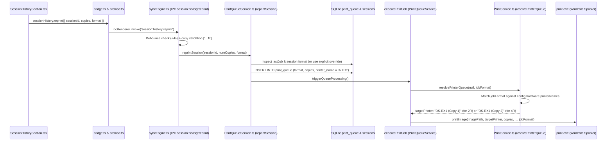

# PR-02 — ADMIN SESSION HISTORY MANUAL PRINT FIX & PRINT CONTROLS REPORT

**Document ID:** `DOC-PR02-ADMIN-PRINT-FIX-001`  
**Execution Date:** 2026-10-11  
**Author:** Antigravity Core Engineering  
**Branch:** `feature/pr02-printer-profiles-calibration`  
**HEAD Commit:** [`f478182`](file:///c:/Users/ezarh/.gemini/antigravity-ide/scratch/Pictolabs/pictolabs-rebuild) (`fix(pr02): decouple admin manual print format and copy controls with strict queue routing`)  
**Parent Workstream:** Printer Workstream / Pilot Readiness Feature Batch (Phase B — PR-02)  
**Status:** COMPLETE — AUTOMATED REGRESSION TESTS PASSED (AWAITING CHATGPT AUDIT & FOUNDER PHYSICAL UAT)  

---

## 1. Executive Summary & Verification Matrix

During Founder Physical UAT on Booth #1 hardware, the following behavior was observed:
- **Configuration Persistence across restart**: PASS.
- **Normal Customer 2R Session**: PASS (output: two 2×6-inch strips cut cleanly).
- **Manual Reprint from Admin Panel Session History Detail**: FAIL — printing manually from the Session History detail dialog produced **4R uncut output** for a 2R session instead of two 2×6-inch strips.
- **Operator Controls**: The UI previously coupled print format and copies into two rigid buttons (`1 Lembar` vs `2 Lembar (Strip Cut)`), which conflated the physical paper format with the copy count.

### Targeted Resolution:
1. **Decoupled Operator Controls**: The Admin Panel now provides two independent controls:
   - **Print Format Selector**: Explicit toggle between `2R (Cut)` (Strip 2×6, pisau aktif) and `4R (Uncut)` (Photo 4×6, tanpa potong), with automatic preselection of the session's detected original format and an `"Asli"` badge.
   - **Numeric Copy Stepper & Input**: Dedicated counter allowing the operator to select 1 to 10 copies, with strict positive-integer validation and direct keypad input.
   - **Live Confirmation Action**: The reprint button dynamically reflects the operator's exact configuration before dispatch: e.g. `Cetak Ulang (2R Cut • 2x)`.
2. **Eliminated Queue Bypass**: Manual reprint jobs in `print_queue` now strictly enforce `printer_name: 'AUTO'`. Stale printer names or default printer fallbacks are never hardcoded into the queue item, ensuring `PrintService.resolvePrinterQueue` dynamically resolves the queue strictly according to media format.
3. **Parity Fail-Fast Guards**: `resolvePrinterQueue` now enforces strict fail-fast validation for `4R` (identical to existing `2R` behavior) and rejects queues with cut keywords when printing 4R uncut.

```text
┌──────────────────────────────────────────┬──────────┬────────────────────────────────────────────────────────┐
│ Verification Level                       │ Status   │ Empirical Evidence                                     │
├──────────────────────────────────────────┼──────────┼────────────────────────────────────────────────────────┤
│ 1. Git Branch & Commits                  │ COMPLETE │ Commit f478182 on feature/pr02-printer-profiles        │
│ 2. Automated Regression Tests            │ PASSED   │ 33/33 Task A, B & C PASS (scripts/test_pr02_founder)   │
│ 3. Checkpoint & Regression Suites        │ PASSED   │ 17/17 Blocker PASS; 25/25 Checkpoints; 36/36 RCA-6     │
│ 4. Build & Typecheck                     │ PASSED   │ Kiosk tsc clean, Vite bundle clean, Backend nest clean │
│ 5. Founder Physical Hardware UAT         │ PENDING  │ Awaiting ChatGPT Audit before physical print on Booth 1│
└──────────────────────────────────────────┴──────────┴────────────────────────────────────────────────────────┘
```

---

## 2. Root Cause Analysis (RCA)

### 2.1 Complete End-to-End Trace of the Admin Manual Print Path


### 2.2 Why Did the Observed 2R Admin Print Use the 4R Uncut Queue?
Three contributing defects were identified:

1. **Defect 1: UI Conflated Format with Copy Count**:
   In `SessionHistorySection.tsx`, the copy selector had two buttons:
   - `1 Lembar` -> set `reprintCopies = 1`
   - `2 Lembar (Strip Cut)` -> set `reprintCopies = 2`
   When `handleReprint` was clicked, it invoked `sessionHistory.reprint({ sessionId, copies })`. **No `format` parameter was passed.** The IPC bridge and preload API also lacked any `format` field.
2. **Defect 2: `PrintQueueService.reprintSession` Hardcoded Stale Printer Name Bypassing Format Routing**:
   In previous iterations of `PrintQueueService.ts:reprintSession`, the query set:
   ```typescript
   const printer = targetPrinter || getDefaultPrinterName() || 'AUTO';
   ```
   On Booth #1, the Windows default printer is configured as `DS-RX1 (Copy 2)` (the 4R uncut queue). As a result, the queue item had `printer_name = 'DS-RX1 (Copy 2)'`. When `executePrintJob` executed, line 680 evaluated:
   ```typescript
   const candidatePrinter = (item.printer_name && item.printer_name !== 'Default Printer' && item.printer_name !== 'AUTO')
     ? item.printer_name
     : null;
   ```
   Because `candidatePrinter` was `'DS-RX1 (Copy 2)'`, `resolvePrinterQueue` matched it directly against installed Windows printers, **completely bypassing media format routing**!
3. **Defect 3: Lack of Fail-Fast Guard for Unconfigured 4R Queue**:
   In `PrintService.ts:resolvePrinterQueue`, only `2R` had a fail-fast check when unconfigured. `4R` lacked a check and would fall back to `getDefaultPrinterName()`, creating asymmetric behavior.

---

## 3. Implementation Details

### 3.1 IPC & Preload Contracts
- [`apps/kiosk/src/ipc/bridge.ts`](file:///c:/Users/ezarh/.gemini/antigravity-ide/scratch/Pictolabs/pictolabs-rebuild/apps/kiosk/src/ipc/bridge.ts):
  - Added `printFormat?: '2R' | '4R' | '6R' | null;` to `KioskSessionHistoryItem`.
  - Added `format?: '2R' | '4R' | string;` to `KioskSessionHistoryAPI.reprint`.
- [`apps/kiosk/electron/preload.ts`](file:///c:/Users/ezarh/.gemini/antigravity-ide/scratch/Pictolabs/pictolabs-rebuild/apps/kiosk/electron/preload.ts):
  - Updated `sessionHistory.reprint` to forward `params.format`.

### 3.2 SyncEngine & SQLite History
- [`apps/kiosk/electron/services/SyncEngine.ts`](file:///c:/Users/ezarh/.gemini/antigravity-ide/scratch/Pictolabs/pictolabs-rebuild/apps/kiosk/electron/services/SyncEngine.ts):
  - Updated `stmtPrint` in `getSessionHistory` to query `format` from `print_queue`.
  - Added `printFormat` to `KioskSessionHistoryItem` so the UI knows the authoritative original format.
  - In `reprintSessionWithDebounce`: Added strict integer validation for copies `[1..10]`, accepted `format?: string`, and passed it to `reprintSession`.
  - In IPC handler `session:history:reprint`: Forwarded `params?.format`.

### 3.3 PrintQueueService: Strict AUTO Queue Invariant
- [`apps/kiosk/electron/services/PrintQueueService.ts`](file:///c:/Users/ezarh/.gemini/antigravity-ide/scratch/Pictolabs/pictolabs-rebuild/apps/kiosk/electron/services/PrintQueueService.ts):
  - `reprintSession(sessionId, overrideCopies, overrideFormat)` validates copies (`[1..10]`) and validates `overrideFormat` (`'2R'`, `'4R'`, `'6R'`).
  - If format is missing or ambiguous, fails fast with an Indonesian error.
  - **Enforces `const printer = 'AUTO';`**: Manual reprint jobs in `print_queue` are always stored with `'AUTO'`, ensuring `executePrintJob` dynamically resolves `strip2x6` vs `photo4x6` via `resolvePrinterQueue(null, format)`.

### 3.4 PrintService: Strict 4R Queue Resolution & Cut Guard
- [`apps/kiosk/electron/services/PrintService.ts`](file:///c:/Users/ezarh/.gemini/antigravity-ide/scratch/Pictolabs/pictolabs-rebuild/apps/kiosk/electron/services/PrintService.ts):
  - Added fail-fast check: If `mediaFormat === '4R'` and `photo4x6` is null, returns error: `"Antrean printer 4R (photo 4x6) belum dikonfigurasi di Admin Panel."`.
  - Added cut guard: If printing `4R` and a queue name contains cut keywords (`2x6`, `strip`, `2-inch`, `cut`, `potong`), it is strictly rejected.

### 3.5 SessionHistorySection: Decoupled UI Controls
- [`apps/kiosk/src/screens/SessionHistorySection.tsx`](file:///c:/Users/ezarh/.gemini/antigravity-ide/scratch/Pictolabs/pictolabs-rebuild/apps/kiosk/src/screens/SessionHistorySection.tsx):
  - Added `reprintFormat` state (`'2R' | '4R'`), auto-initialized via `useEffect` whenever `selectedSession` changes:
    - If `session.printFormat === '4R'` or `session.frameId === '4R'`, defaults to `'4R'`.
    - Otherwise, defaults to `'2R'`.
  - Two explicit buttons with descriptive subtitles and an `"Asli"` badge:
    - `2R (Cut)`: *"Dua strip 2×6 inci (pisau aktif)"*
    - `4R (Uncut)`: *"Satu lembar 4×6 inci (tanpa potong)"*
  - Dedicated numeric copy stepper: `[-] [ input: 1..10 ] [+] Lembar`.
  - Confirmation button: `Cetak Ulang (${reprintFormat === '2R' ? '2R Cut' : '4R Uncut'} • ${reprintCopies}x)`.

---

## 4. Verification & Automated Test Evidence

### 4.1 UAT Regression Test Suite (`scripts/test_pr02_founder_uat_fixes.mjs`)
Command: `npx tsx scripts/test_pr02_founder_uat_fixes.mjs`  
Result: **33/33 PASS (100%)**

```text
--- TASK A: CONFIGURATION PERSISTENCE ACROSS RESTART ---
✓ PASS: A1: Custom calibration and 2R/4R queue names written atomically to disk
✓ PASS: A2: Offline restart hydrates exact custom configuration without defaulting
✓ PASS: A3: Online restart with older remote defaults (v1) NEVER overwrites local custom settings
✓ PASS: A4: Cloud push transmits calibration and printer names to backend PUT /api/booths/:id/config
✓ PASS: A5: Multi-booth isolation: Booth A config does not leak into Booth B

--- TASK B: PRODUCT-TO-PRINT FORMAT ROUTING ---
✓ PASS: B1: Enqueueing 2R product explicitly stores format = "2R" in SQLite queue
✓ PASS: B2: Enqueueing 4R product explicitly stores format = "4R" in SQLite queue
✓ PASS: B3: Implicit enqueue resolves format from sessions table (frame_id "2R")
✓ PASS: B4: 2R product routes strictly to configured 2R queue ("DS-RX1 (Copy 1)")
✓ PASS: B5: 4R product routes strictly to configured 4R queue ("DS-RX1 (Copy 2)")
✓ PASS: B6: Unconfigured 2R queue fails fast with actionable error (NO silent default fallback)
✓ PASS: B7: Missing Windows printer for configured 2R queue fails fast with clear error
✓ PASS: B8: Manual reprint of 2R session preserves format = "2R" and creates distinct job
✓ PASS: B8a: Manual reprint of 2R session with frame_id = "classic-white" preserves 2R format from last print job
✓ PASS: B8b: Manual reprint of 4R session preserves persisted 4R job format
✓ PASS: B8c: Legacy session with ambiguous format and no print job fails fast (NEVER silently defaults to 4R)
✓ PASS: B8d: Manual reprint deduplication prevents duplicate enqueue when reprint is already PENDING
✓ PASS: B8e: Manual reprint deduplication prevents duplicate enqueue when reprint is already PRINTING
✓ PASS: B8f: Missing required printer mapping during manual reprint dispatch fails fast to FAILED
✓ PASS: B8g: Manual reprint queue & dispatch locking: Single-dispatch lock prevents concurrent processing
✓ PASS: B9: Idempotency & deduplication: Duplicate 2R enqueue returns existing job without double printing

--- TASK C: ADMIN MANUAL REPRINT & FORMAT/COPY CONTROLS ---
✓ PASS: C1: Operator explicit 2R override on 4R session routes to 2R cut queue ("DS-RX1 (Copy 1)")
✓ PASS: C2: Operator explicit 4R override on 2R session routes to 4R uncut queue ("DS-RX1 (Copy 2)")
✓ PASS: C3: Operator custom copy count enqueues exact count (e.g. 3 copies) without double multiplication
✓ PASS: C4: Copy count validation rejects invalid values (0, negative, >10, fractional, NaN)
✓ PASS: C5: Unconfigured 4R queue fails fast with actionable Indonesian error (NO silent fallback)
✓ PASS: C6: 4R queue configured with cut keywords is strictly rejected (cut protection guard)
✓ PASS: C7: SyncEngine.getSessionHistory exposes authoritative printFormat from print_queue to Admin UI
✓ PASS: C8: End-to-end reprintSessionWithDebounce propagates operator format and custom copies cleanly
✓ PASS: C9: Rapid repeated clicks / double-tap debounce prevents duplicate job creation
✓ PASS: C10: Invalid operator format string is rejected fail-safe
✓ PASS: C11: Existing customer 2R routing remains intact (regression verification)
✓ PASS: C12: Existing configuration persistence and booth isolation remain intact

RESULTS: 33 PASSED / 0 FAILED (100%)
```

### 4.2 Comprehensive Checkpoint & Regression Suites
- `node scripts/test_pr02_checkpoint1_normalization.mjs`: **9/9 PASS**
- `node scripts/test_pr02_checkpoint2_kiosk_hydration.mjs`: **5/5 PASS**
- `node scripts/test_pr02_checkpoint3_dispatch.mjs`: **11/11 PASS**
- `node scripts/test_pr02_blocker_fixes_verification.mjs`: **17/17 PASS**
- `npx tsx apps/kiosk/electron/services/config-hydration.spec.ts`: **10/10 PASS**
- `npx tsx apps/kiosk/electron/services/rca6-regression.spec.ts`: **36/36 PASS**
- `npx tsx apps/kiosk/electron/services/rca7-simplification.spec.ts`: **10/10 PASS**

### 4.3 TypeScript & Build Checks
- `npx tsc --noEmit -p apps/kiosk/tsconfig.electron.json`: **Exit code 0** (0 errors)
- `npm --prefix apps/kiosk run build`: **Exit code 0** (tsc clean, Vite 1,900 modules transformed in 3.37s)
- `npm --prefix apps/backend run build`: **Exit code 0** (Nest build clean)

---

## 5. Git Status & Commit Boundaries

- **Branch:** `feature/pr02-printer-profiles-calibration`
- **HEAD Commit:** [`f478182`](file:///c:/Users/ezarh/.gemini/antigravity-ide/scratch/Pictolabs/pictolabs-rebuild) (`fix(pr02): decouple admin manual print format and copy controls with strict queue routing`)
- **Prior Commit:** [`e74dc2d`](file:///c:/Users/ezarh/.gemini/antigravity-ide/scratch/Pictolabs/pictolabs-rebuild) (`fix(pr02): preserve physical print format during manual reprint and prevent duplicate enqueues`)
- **Remote / VPS / Physical Boundaries:**
  - Zero commits pushed to GitHub remote (`origin`).
  - Zero physical prints executed.
  - Monorepo clean and ready for ChatGPT review before physical UAT.

---

## 6. Physical UAT Protocol for Founder Retest

When Founder tests on Booth #1 hardware:

### Test Case 1: Session History 2R Reprint
1. Open Admin Panel -> **Riwayat Sesi**.
2. Select a customer 2R photostrip session.
3. Observe Format selector: `2R (Cut)` is preselected with the `"Asli"` badge.
4. Set copies to `1`.
5. Observe button text: `Cetak Ulang (2R Cut • 1x)`.
6. Click **Cetak Ulang**.
7. **Expected Physical Result**: Dispatches to `DS-RX1 (Copy 1)` (the 2R strip queue); printer cuts output into two 2×6-inch strips.

### Test Case 2: Intentional Format Override to 4R Uncut
1. Select the same 2R session in **Riwayat Sesi**.
2. Explicitly click `4R (Uncut)`.
3. Set copies to `1`.
4. Observe button text: `Cetak Ulang (4R Uncut • 1x)`.
5. Click **Cetak Ulang**.
6. **Expected Physical Result**: Dispatches to `DS-RX1 (Copy 2)` (the 4R uncut queue); printer outputs a single uncut 4×6-inch sheet.

### Test Case 3: Custom Multi-Copy Reprint
1. Select a 2R session.
2. Select format `2R (Cut)` and set copies to `2`.
3. Observe button text: `Cetak Ulang (2R Cut • 2x)`.
4. Click **Cetak Ulang**.
5. **Expected Physical Result**: Exactly 2 sheets are fed and cut into 4 strips total (2 sets of 2 strips).
